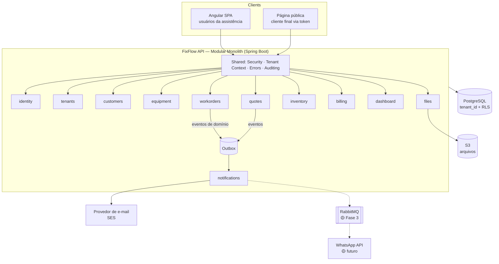
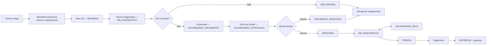
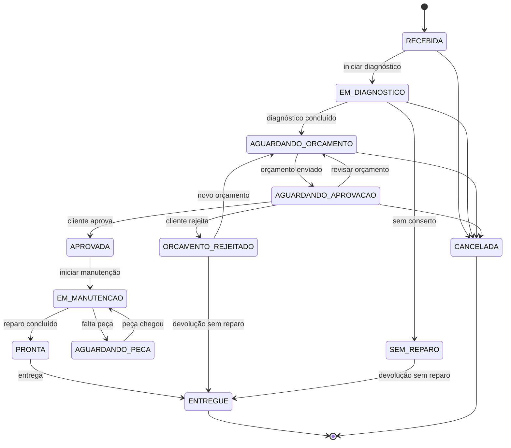
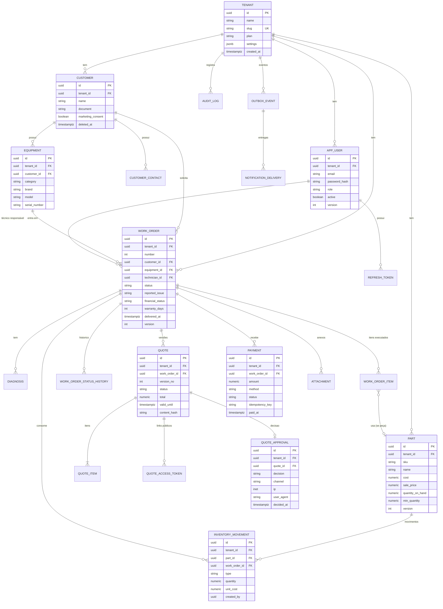
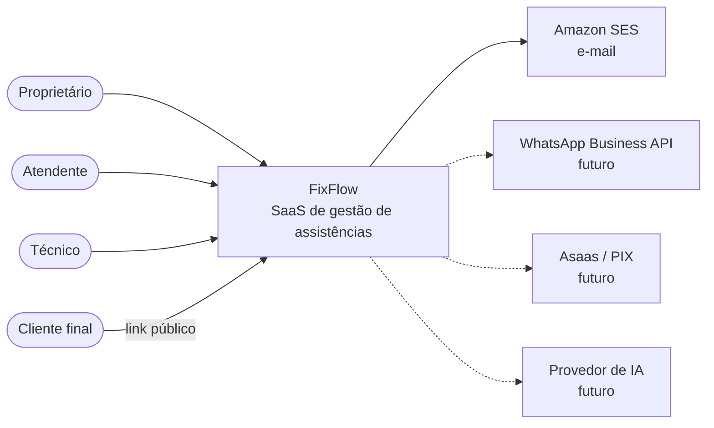
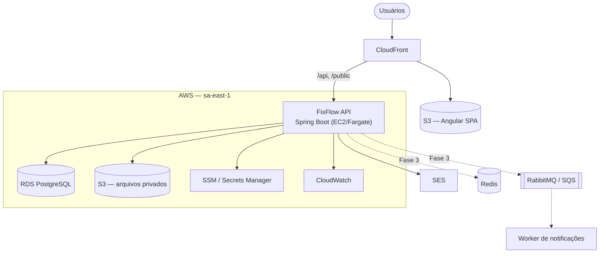
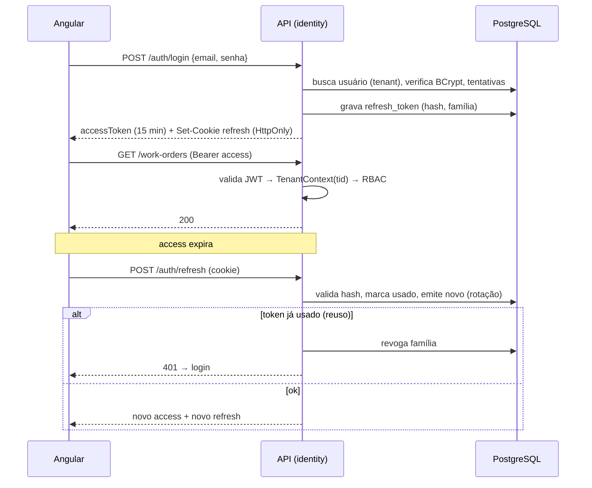
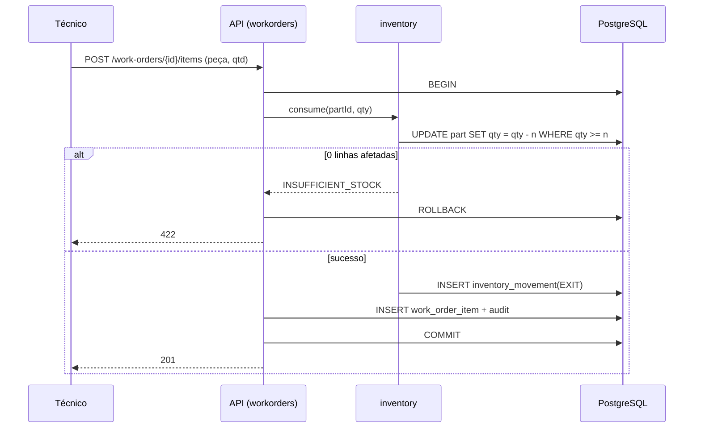
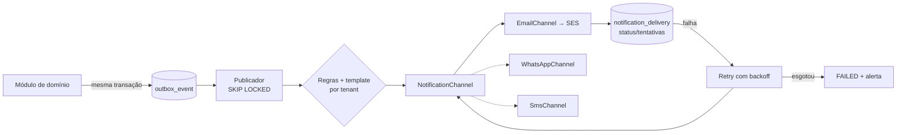

# FixFlow — Documento Técnico
### SaaS B2B multi-tenant para gestão de assistências técnicas

| | |
|---|---|
| **Produto (nome provisório)** | FixFlow |
| **Versão do documento** | 0.1 (rascunho para validação) |
| **Data** | 05/10/2026 |
| **Status** | Pré-desenvolvimento (Fase 0 — Validação) |
| **Stack base** | Java 21 + Spring Boot 3.x, Angular, PostgreSQL, AWS |

## Controle de versão

| Versão | Data | Autor | Alterações |
|---|---|---|---|
| 0.1 | 05/10/2026 | Arquitetura | Primeira versão completa para revisão |

## Sumário

1. Visão geral · 2. Objetivos · 3. Problema · 4. Público-alvo · 5. Personas e RBAC · 6. Requisitos funcionais · 7. Requisitos não funcionais · 8. Casos de uso · 9. Arquitetura · 10. Multi-tenancy · 11. Segurança · 12. Módulos · 13. Fluxos · 14. Máquina de estados · 15. Banco de dados · 16. API · 17. Autenticação · 18. Notificações · 19. Estoque · 20. Financeiro · 21. IA · 22. Auditoria · 23. Observabilidade · 24. Testes · 25. Infraestrutura · 26. CI/CD · 27. LGPD · 28. Planos SaaS · 29. Roadmap · 30. Backlog · 31. ADRs · 32. Diagramas · 33. Definition of Done · 34. Glossário · 35. Recomendações do Arquiteto

> **Legenda de escopo:** 🟢 MVP · 🟡 Versão futura · 🔴 Fora do escopo / experimental.

---

# 1. Visão geral

**FixFlow** é um SaaS B2B multi-tenant que controla o ciclo completo de uma assistência técnica:

`Cliente → Equipamento → OS → Diagnóstico → Orçamento → Aprovação → Manutenção → Pagamento → Entrega → Garantia`

**Proposta de valor:** *"Cada equipamento rastreado, cada orçamento aprovado por link, cada cliente informado — sem planilha e sem caderno."*

**Posicionamento comercial:** sistema de OS **simples, barato e rápido de implantar** para assistências pequenas e médias (1–10 colaboradores), no espaço entre planilha/caderno e ERPs genéricos caros ou complexos. Diferenciais a validar:

1. Aprovação de orçamento pelo cliente via link seguro (evidência auditável).
2. Comunicação automática de status (WhatsApp na fase 2/3).
3. Implantação em menos de 1 dia (cadastro mínimo, sem treinamento longo).
4. Preço previsível por plano.

**Funcionalidades:**

| Categoria | Itens |
|---|---|
| 🟢 MVP | Autenticação/RBAC, tenant, clientes, equipamentos, OS com máquina de estados, diagnóstico, orçamento, aprovação por link, estoque básico, pagamento manual, e-mail, dashboard básico, auditoria, fotos |
| 🟡 Futuro | WhatsApp, cobrança via PIX/gateway, garantia com alertas, relatórios avançados, importação de dados, app do técnico (PWA), IA assistiva |
| 🔴 Fora do escopo inicial | NF-e/NFS-e, multi-filial, marketplace de peças, portal completo com conta do cliente, BI customizável, funcionalidades específicas por tipo de equipamento (ex.: checklist de celular), contabilidade |

# 2. Objetivos

**Negócio:** validar com 3–5 assistências reais; atingir 10 clientes pagantes em até 6 meses após o MVP; churn mensal < 5%.
**Produto:** reduzir o tempo de abertura de OS para < 2 min; ≥ 60% dos orçamentos respondidos via link; zero extravio de equipamento sem registro.
**Técnicos:** isolamento de tenant comprovado por testes; custo de infraestrutura < ~US$ 80/mês no MVP; deploy automatizado; evolução sem reescrita.

# 3. Problema

| Dor | Consequência |
|---|---|
| OS em papel/caderno/WhatsApp pessoal | Perda de informação, retrabalho, disputa com cliente |
| Orçamento aprovado "de boca" | Cliente nega depois; prejuízo com peça comprada |
| Cliente liga perguntando status | Interrompe o técnico, má experiência |
| Peças sem controle | Falta/sobra, custo desconhecido |
| Sem histórico por equipamento/cliente | Garantia mal controlada, diagnóstico repetido |
| Sem indicadores | Dono não sabe faturamento, ticket, gargalos |

# 4. Público-alvo

- **Primário:** assistências técnicas independentes de informática (computadores, notebooks, impressoras, periféricos, eletrônicos) com 1–10 pessoas.
- **Secundário:** redes pequenas (futuro, multi-filial — 🔴).
- **Comprador:** o dono. **Usuário diário:** atendente e técnico.

# 5. Personas e RBAC

| Persona | Perfil | Dor principal | Objetivo |
|---|---|---|---|
| **Marcos — Proprietário** (42) | Dono de assistência com 4 funcionários | Não sabe quanto lucra por OS | Controle e visibilidade |
| **Rafael — Técnico** (28) | Bancada, pouco tempo para sistema | Burocracia | Registrar em poucos cliques, ver sua fila |
| **Juliana — Atendente** (24) | Balcão e telefone | Cliente cobrando status; retrabalho | Abrir OS rápido, enviar orçamento |
| **Cláudia — Cliente final** | Usa só o celular | Não saber o que está acontecendo | Ver status, aprovar sem criar conta |

## Matriz RBAC (MVP)

Roles fixas no MVP (OWNER, TECHNICIAN, ATTENDANT); permissões granulares como constantes no código, preparadas para roles customizáveis (🟡).

| Permissão | OWNER | ATTENDANT | TECHNICIAN |
|---|:-:|:-:|:-:|
| `tenant:manage` (config empresa, plano) | ✅ | ❌ | ❌ |
| `user:manage` | ✅ | ❌ | ❌ |
| `customer:read/write` | ✅ | ✅ | read |
| `equipment:read/write` | ✅ | ✅ | read + write limitado |
| `workorder:create` | ✅ | ✅ | ❌ |
| `workorder:read` | ✅ todas | ✅ todas | ✅ atribuídas (+ não atribuídas, se configurado) |
| `workorder:assign` | ✅ | ✅ | ❌ |
| `workorder:diagnose` / `workorder:execute` | ✅ | ❌ | ✅ (atribuídas) |
| `quote:create/send` | ✅ | ✅ | create (rascunho) |
| `quote:manual_approve` (aprovação por telefone) | ✅ | ✅ (com justificativa) | ❌ |
| `inventory:read` | ✅ | ✅ | ✅ |
| `inventory:write` (entrada/ajuste) | ✅ | ❌ | ❌ |
| `payment:register` | ✅ | ✅ | ❌ |
| `finance:read` / `dashboard:financial` | ✅ | ❌ | ❌ |
| `audit:read` | ✅ | ❌ | ❌ |

**Cliente final:** sem conta; acessa via **token público** (seção 17.4), escopo restrito a uma única OS.

# 6. Requisitos funcionais

| ID | Requisito | Prior. |
|---|---|---|
| RF-01 | Login/logout/refresh/recuperação de senha | P0 |
| RF-02 | Cadastro e configuração do tenant (dados da empresa, termos de garantia padrão, logo) | P0 |
| RF-03 | CRUD de usuários e atribuição de role | P0 |
| RF-04 | CRUD de clientes (PF/PJ), contatos, endereço, busca por nome/telefone/documento | P0 |
| RF-05 | CRUD de equipamentos vinculados ao cliente (categoria, marca, modelo, nº série, acessórios, estado físico, fotos) | P0 |
| RF-06 | Abrir OS (cliente + equipamento + defeito relatado + acessórios + estado físico) com número sequencial por tenant | P0 |
| RF-07 | Atribuir técnico, alterar status conforme máquina de estados | P0 |
| RF-08 | Registrar diagnóstico (texto, causa, solução proposta) | P0 |
| RF-09 | Montar orçamento (serviços + peças + desconto) com cálculo automático | P0 |
| RF-10 | Enviar orçamento por link público (e-mail; copiar link para WhatsApp manual) | P0 |
| RF-11 | Cliente aprovar/rejeitar via link, com evidência | P0 |
| RF-12 | Aprovação manual por atendente (telefone/balcão) com justificativa | P0 |
| RF-13 | Registro de peças usadas com baixa de estoque | P0 |
| RF-14 | Cadastro de peças, entradas, ajustes, estoque mínimo, histórico | P0 |
| RF-15 | Registrar pagamento (manual: dinheiro, PIX, cartão, transferência), parcial ou total | P0 |
| RF-16 | Entrega do equipamento com data e garantia calculada | P0 |
| RF-17 | Upload de fotos/documentos da OS | P0 |
| RF-18 | Histórico/timeline da OS | P0 |
| RF-19 | Dashboard (OS por status, faturamento, ticket médio, tempo médio) | P1 |
| RF-20 | Notificações por e-mail em eventos-chave | P1 |
| RF-21 | Notificações internas (sino) | P2 |
| RF-22 | WhatsApp automatizado | P2 (Fase 3) |
| RF-23 | Impressão de OS/orçamento/termo (PDF) | P1 |
| RF-24 | Alerta de garantia a vencer | P2 |
| RF-25 | Cobrança via PIX/gateway | P3 |
| RF-26 | Recursos de IA assistiva | P3 |

# 7. Requisitos não funcionais

| Categoria | Requisito (métrica) | Observação |
|---|---|---|
| Disponibilidade | 99,5% mensal no MVP (~3,6 h/mês de indisponibilidade tolerada) | Single-AZ app; RDS Multi-AZ só quando houver SLA pago |
| Performance | API p95 < 500 ms em operações comuns; p99 < 1,5 s; listagens sempre paginadas (máx. 100/página) | |
| Segurança | OWASP ASVS nível 1 como alvo; senhas BCrypt cost ≥ 12; TLS 1.2+ obrigatório | |
| Escalabilidade | Suportar 100 tenants / ~50 req/s sem mudança de arquitetura | Seção 25.4 |
| Observabilidade | Logs JSON com `requestId`, `tenantId`, `userId`; health checks; alerta de erro 5xx | |
| Manutenção | Cobertura ≥ 70% no domínio; ArchUnit validando fronteiras de módulos; Flyway obrigatório | |
| Backup | RDS backup automático 7 dias + snapshot semanal; **RPO ≤ 24 h (alvo 5 min com PITR)**; **RTO ≤ 4 h** | Teste de restauração trimestral |
| Integrações externas | Timeout 5 s, retry com backoff exponencial (máx. 3), circuit breaker só em WhatsApp/e-mail (Resilience4j) | |
| Uploads | Máx. 10 MB/arquivo, 20 arquivos/OS | Seção 11.5 |
| Privacidade/LGPD | Seção 27 | |
| Usabilidade | Abrir OS em ≤ 2 min; responsivo (técnico usa celular/tablet) | |

# 8. Casos de uso

| ID | Caso de uso | Ator | Resumo |
|---|---|---|---|
| UC-01 | Abrir OS | Atendente | Busca/cria cliente, busca/cria equipamento, registra defeito e acessórios → OS `RECEBIDA` |
| UC-02 | Diagnosticar | Técnico | Assume OS, registra diagnóstico → `AGUARDANDO_ORCAMENTO` |
| UC-03 | Elaborar e enviar orçamento | Técnico/Atendente | Adiciona itens, sistema calcula, atendente envia link → `AGUARDANDO_APROVACAO` |
| UC-04 | Aprovar/rejeitar orçamento | Cliente final | Abre link, revisa, decide → `APROVADA` ou `ORCAMENTO_REJEITADO` |
| UC-05 | Executar manutenção | Técnico | Registra peças usadas (baixa estoque), pausa por falta de peça, conclui → `PRONTA` |
| UC-06 | Receber pagamento e entregar | Atendente | Registra pagamento, entrega, inicia garantia → `ENTREGUE` |
| UC-07 | Gerenciar estoque | Owner | Entrada, ajuste, consulta de mínimos |
| UC-08 | Acompanhar indicadores | Owner | Dashboard |
| UC-09 | Gerenciar usuários | Owner | Convite, desativação, troca de role |

---

# 9. Arquitetura

## 9.1 Comparação

| Critério | Monólito tradicional | **Modular Monolith** | Microsserviços |
|---|---|---|---|
| Complexidade operacional | Baixa | **Baixa** | Alta (rede, deploy, observabilidade distribuída) |
| Custo de infra | Mínimo | **Mínimo** | 3–10× maior |
| Fronteiras de domínio | Frágeis (vira "big ball of mud") | **Explícitas e verificáveis (ArchUnit)** | Explícitas (físicas) |
| Consistência transacional | Simples | **Simples (ACID local)** | Difícil (sagas, consistência eventual) |
| Time necessário | 1–3 devs | **1–5 devs** | 5+ devs com DevOps |
| Evolução para extração | Difícil | **Natural** | n/a |

**Decisão: Modular Monolith** (ADR-001). Motivos: equipe pequena, domínio fortemente transacional (OS ↔ estoque ↔ orçamento ↔ pagamento exigem atomicidade), custo mínimo e necessidade de iterar rápido sobre o produto. As fronteiras entre módulos são impostas **no código** (pacotes, API pública por módulo, eventos) para permitir extração futura **somente** se houver necessidade medida (ex.: notificações com carga própria).

## 9.2 Diagrama de arquitetura (visão lógica)



## 9.3 Módulos, responsabilidades e dependências

| Módulo | Responsabilidade | Depende de (via API pública) |
|---|---|---|
| `identity` | Usuários, autenticação, tokens, roles/permissões | `tenants` |
| `tenants` | Empresa, plano, configurações, limites | — |
| `customers` | Clientes, contatos, endereços | — |
| `equipment` | Equipamentos do cliente, fotos (metadados) | `customers`, `files` |
| `workorders` | OS, máquina de estados, diagnóstico, itens, histórico, garantia | `customers`, `equipment`, `inventory`, `identity` |
| `quotes` | Orçamento, itens, aprovação/rejeição, link público | `workorders` |
| `inventory` | Peças, saldo, movimentações | — |
| `billing` | Pagamentos, status financeiro | `workorders`, `quotes` |
| `notifications` | Templates, canais, entrega, preferências | consome eventos (nenhuma dependência de saída para o domínio) |
| `dashboard` | Consultas de leitura agregadas (read-only) | leitura de vários |
| `files` | Upload, validação, storage, URLs temporárias | — |
| `shared` | Segurança, tenant context, exceções, auditoria, infraestrutura | — |

**Regras de dependência (verificadas com ArchUnit):**
1. Módulo só acessa outro módulo pela sua **API pública** (`api` package/interfaces + eventos); nunca `repository`/`entity` alheios.
2. Sem ciclos entre módulos (`workorders → inventory` ok; `inventory → workorders` proibido).
3. `notifications` **nunca** é chamado diretamente pelo domínio; só consome eventos.
4. `domain` não importa Spring/JPA (ver 9.5).

## 9.4 Comunicação entre módulos

- **Síncrona (chamada de interface):** quando precisa de resposta/transação (ex.: `workorders` → `inventory.reserve/consume(...)` na mesma transação).
- **Assíncrona (eventos de domínio + Outbox):** efeitos colaterais não críticos (notificações, auditoria enriquecida, métricas). Evento gravado na **mesma transação** da mudança (Transactional Outbox) → publicador entrega ao consumidor interno (Spring `ApplicationEventPublisher` no MVP; RabbitMQ na Fase 3).

## 9.5 Estrutura do projeto backend (hexagonal leve por módulo)

```text
src/main/java/br/com/fixflow/
 ├── modules/
 │   ├── workorders/
 │   │   ├── api/              # interface pública do módulo + eventos publicados
 │   │   ├── domain/           # entidades ricas, value objects, state machine, regras (sem Spring/JPA)
 │   │   ├── application/      # casos de uso (@Service, @Transactional), ports (interfaces)
 │   │   ├── infrastructure/   # adapters: JPA entities/repositories, mapeadores
 │   │   └── web/              # controllers REST, DTOs, validação
 │   ├── identity/  tenants/  customers/  equipment/
 │   ├── quotes/  inventory/  billing/  notifications/  files/  dashboard/
 │
 ├── shared/
 │   ├── security/      # JWT filter, TenantContext, permission evaluator
 │   ├── tenancy/       # TenantContext, Hibernate TenantIdentifier, RLS session setter
 │   ├── exceptions/    # ProblemDetail (RFC 9457), handlers
 │   ├── auditing/      # AuditService, listeners
 │   ├── outbox/        # OutboxEvent, publisher
 │   └── infrastructure/  # clock, id generator, storage port, mail port
 └── config/            # Security, Jackson, OpenAPI, Async, Flyway
src/main/resources/db/migration/   # Flyway
```

| Camada | Responsabilidade | Não pode |
|---|---|---|
| `web` | HTTP, DTOs, validação de entrada, mapeamento de erros | Regra de negócio |
| `application` | Orquestra casos de uso, transação, autorização por caso de uso, publica eventos | Conhecer HTTP |
| `domain` | Regras de negócio, invariantes, state machine | Importar Spring/JPA/Jackson |
| `infrastructure` | Persistência, S3, SMTP, WhatsApp adapters | Conter regra de negócio |

> **Pragmatismo:** para módulos CRUD simples (`customers`, `tenants`), é aceitável usar entidade JPA diretamente como domínio. A separação domínio/JPA rigorosa é aplicada em `workorders`, `quotes`, `inventory` e `billing`, onde há regra relevante.

## 9.6 Padrões de projeto (somente onde resolvem problema real)

| Padrão | Problema | Solução / onde | Motivo |
|---|---|---|---|
| **State Machine** | Transições inválidas de OS | Enum de estados + tabela de transições + guards (`WorkOrderStateMachine`) | Regra central do produto; testável isoladamente |
| **Repository** | Isolar persistência do domínio | Ports no `application`, implementação JPA | Testabilidade e troca de storage |
| **Observer/Event (Outbox)** | Acoplamento entre OS e notificações | Eventos de domínio | Desacopla WhatsApp/e-mail do domínio |
| **Adapter** | Dependências externas (e-mail, WhatsApp, S3, gateway) | `NotificationChannel`, `FileStorage`, `PaymentGateway` | Permite trocar fornecedor |
| **Strategy** | Múltiplos canais de notificação / cálculo de desconto | `NotificationChannel` por canal; `DiscountPolicy` (🟡) | Evita `if/else` por canal |
| **Factory** | Criação de OS com invariantes (número sequencial, estado inicial, evento) | `WorkOrder.open(...)` (static factory) | Garante OS válida desde a criação |
| **Specification** | Filtros dinâmicos de listagem | Spring Data `Specification` com `tenant` sempre aplicado | Filtros combináveis sem explosão de métodos |
| **Facade** | Dashboard consolida vários módulos | `DashboardQueryService` | Uma API simples sobre várias leituras |

*Não usados:* CQRS completo, Event Sourcing, Saga (sem necessidade no MVP).

---

# 10. Multi-tenancy

## 10.1 Conceitos

- **Tenant** = uma empresa assistência técnica cliente do FixFlow (unidade de isolamento, cobrança e configuração).
- Todo dado de negócio pertence a **exatamente um** tenant (`tenant_id UUID NOT NULL`).
- `User` pertence a **um** tenant (MVP). *Futuro:* usuário em múltiplos tenants (contador, consultor) via tabela `membership`.
- Cliente final **não** é tenant nem usuário: é registro (`customer`) dentro de um tenant.

## 10.2 Estratégias avaliadas

| Critério | Banco por tenant | Schema por tenant | **Coluna `tenant_id`** |
|---|---|---|---|
| Isolamento | Máximo | Alto | Lógico (depende de disciplina + RLS) |
| Custo | Muito alto (instâncias/conexões) | Médio | **Mínimo** |
| Migrations | N bancos | N schemas (lento com muitos tenants) | **1 execução** |
| Onboarding | Provisionar banco | Criar schema + migrar | **Inserir linha** |
| Conexões/pool | Complexo | Médio (search_path) | **Simples** |
| Backup/restore por tenant | Fácil | Médio | Difícil (exige export lógico) |
| Risco de vazamento | Baixo | Baixo | **Alto se mal implementado** → mitigar |
| Escala 1–1000 tenants pequenos | Inviável | Limite prático (~centenas) | **Adequada** |

**Decisão (ADR-002): `tenant_id` em todas as tabelas + defesa em profundidade**, pois os tenants são pequenos, homogêneos e numerosos, e o custo/simplicidade é prioridade. Para mitigar o risco principal:

1. **Camada de aplicação:** Hibernate `@TenantId` (6.x) nas entidades — o Hibernate injeta `tenant_id` em INSERT e filtra em SELECT/UPDATE/DELETE por entidade; ou `@Filter` global habilitado por interceptor.
2. **Camada de banco:** **PostgreSQL Row-Level Security (RLS)** como rede de segurança: `CREATE POLICY tenant_isolation USING (tenant_id = current_setting('app.tenant_id')::uuid)`. A aplicação executa `SET LOCAL app.tenant_id = '<uuid>'` no início de cada transação. A role de runtime **não** é owner das tabelas (owners ignoram RLS) e não tem `BYPASSRLS`.
3. **FKs compostas:** `(tenant_id, id)` como UNIQUE e FKs referenciando ambas as colunas → impossível ligar entidade do tenant A a registro do tenant B.
4. **Testes automatizados de isolamento** (seção 24) rodando em CI.
5. **Rota de saída:** tenants grandes/enterprise podem migrar para banco dedicado no futuro (o código é igual; só muda o `DataSource` roteado).

## 10.3 Identificação do tenant na requisição

1. `tenant_id` é **claim do JWT** (`tid`) — nunca vem de header/param controlável pelo cliente.
2. `TenantFilter` (após autenticação) popula `TenantContext` (ThreadLocal; limpo no `finally`).
3. Endpoints públicos: o tenant é **derivado do token público** (lookup por hash), nunca informado pelo cliente.
4. Subdomínio por tenant (`minhaloja.fixflow.app`) → 🟡 (apenas branding; não é fonte de autorização).

## 10.4 Aplicação em repositories/queries

- Regra: **nenhuma query sem tenant**. Entidades de negócio usam `@TenantId`; queries nativas **devem** incluir `tenant_id = :tenantId` (revisão + teste ArchUnit proibindo `@Query(nativeQuery=true)` sem `tenant_id`).
- `findById` → sempre `findByIdAndTenantId` (ou filtro automático). Recurso de outro tenant retorna **404** (não 403, para não confirmar existência).

## 10.5 Jobs, cache, mensageria, logs

| Contexto | Regra |
|---|---|
| **Jobs assíncronos** (`@Scheduled`, `@Async`) | Contexto não é herdado automaticamente. Job recebe `tenantId` explícito; wrapper `TenantScope.run(tenantId, () -> ...)` define contexto e `SET LOCAL`. Jobs "globais" iteram por tenant. `TaskDecorator` propaga o contexto em `@Async`. |
| **Cache** (Caffeine local no MVP; Redis futuro) | Chave **sempre** prefixada: `t:{tenantId}:{entidade}:{id}`. Proibido cache sem tenant na chave. |
| **Mensageria** | Todo evento carrega `tenantId` no envelope/header; consumidor restaura `TenantContext` antes de processar. Filas compartilhadas com `tenantId` na mensagem (MVP). |
| **Logs** | MDC com `tenantId`, `userId`, `requestId`. Logs **nunca** misturam dados pessoais em texto livre (ver LGPD). |
| **Arquivos (S3)** | Chave `tenants/{tenantId}/work-orders/{woId}/{uuid}.ext`; acesso sempre via backend (URL pré-assinada curta após checar autorização). |
| **Sequências** | Número da OS por tenant (`work_order_number_seq` por tenant via tabela de contador com `UPDATE ... RETURNING`). |

---

# 11. Segurança

## 11.1 Modelo de ameaça (resumo)

Ativos críticos: dados de clientes dos tenants (LGPD), isolamento entre tenants, integridade das aprovações de orçamento, credenciais. Atacantes: usuário malicioso de um tenant (tenta IDOR), internet anônima (endpoints públicos/login), conta comprometida, insider.

## 11.2 Matriz de riscos (OWASP)

| # | Risco | Impacto | Prob. | Mitigação |
|---|---|---|---|---|
| 1 | **Broken Access Control / IDOR** (acessar OS/cliente de outro tenant ou de outro usuário) | Crítico | Alta | `@TenantId` + RLS + FKs compostas; checagem de permissão por caso de uso; 404 em recurso alheio; IDs UUID (não substitui autorização); testes de isolamento em CI |
| 2 | **Vazamento entre tenants por query nativa/cache/job** | Crítico | Média | ArchUnit; chave de cache com tenant; `TenantScope` em jobs; RLS |
| 3 | **Autenticação fraca / credential stuffing** | Alto | Alta | BCrypt cost 12, política mínima de senha, rate limit por IP+e-mail, bloqueio progressivo, mensagem genérica no login, 2FA 🟡 |
| 4 | **Roubo de refresh token** | Alto | Média | Rotação + detecção de reuso (revoga família), armazenado como hash, cookie `HttpOnly; Secure; SameSite` |
| 5 | **Token público de OS adivinhado/vazado** | Alto | Baixa | 256 bits aleatórios, hash no banco, expiração, escopo limitado, rate limit, revogação |
| 6 | **SQL Injection** | Crítico | Baixa | JPA/parâmetros; proibido concatenar SQL; `Specification`; análise SAST |
| 7 | **XSS** (campos livres: defeito, observações; nome do cliente) | Alto | Média | Angular escapa por padrão; nunca `innerHTML`/`bypassSecurityTrust*`; CSP; sanitização de rich text (se existir); PDFs com escape |
| 8 | **CSRF** | Médio | Baixa | Access token em header `Authorization` (imune); se refresh em cookie: `SameSite=Strict` + endpoint `/auth/refresh` com header customizado/CSRF token |
| 9 | **Exposição excessiva de dados** (DTO retorna entidade inteira) | Alto | Média | DTOs explícitos; nunca expor entidade; página pública mostra campos mínimos |
| 10 | **Secrets em código/imagem** | Alto | Média | AWS Secrets Manager/SSM Parameter Store; `gitleaks` no CI; sem `.env` versionado |
| 11 | **Upload malicioso** | Alto | Média | Seção 11.5 |
| 12 | **Rate limiting ausente / DoS** | Médio | Média | Bucket4j (in-memory) por IP/usuário; WAF/CloudFront rate rules 🟡; limites de tamanho de payload |
| 13 | **Logs com dados sensíveis** | Médio | Média | Mascaramento (CPF, e-mail, telefone, tokens); proibido logar corpo de requests de auth |
| 14 | **Dependências vulneráveis** | Médio | Alta | Dependabot + OWASP Dependency-Check/Trivy no CI |
| 15 | **Mass assignment** | Médio | Média | DTOs de entrada sem campos de `tenantId`, `status`, `role` |
| 16 | **Enumeração de usuários** (recuperação de senha) | Baixo | Média | Resposta idêntica independentemente de existir conta |
| 17 | **Clickjacking / headers inseguros** | Baixo | Média | `X-Frame-Options: DENY`, HSTS, `X-Content-Type-Options`, CSP |
| 18 | **Aprovação repudiada pelo cliente** | Médio | Média | Evidência (IP, user-agent, timestamp, hash do conteúdo do orçamento, versão) |

## 11.3 CORS

Allowlist explícita de origens (domínio do SPA); sem `*` com credenciais; métodos/headers mínimos. Endpoints públicos aceitam apenas a origem do app público.

## 11.4 Segurança de endpoints públicos

Ver seção 17.4 (token, rate limit, auditoria, escopo mínimo).

## 11.5 Upload de arquivos

| Item | Decisão (MVP) |
|---|---|
| Armazenamento | **S3** (bucket privado, SSE-S3, block public access). Em dev: MinIO/volume local atrás da mesma interface `FileStorage`. **Nunca** BLOB no PostgreSQL; só metadados |
| Limite | 10 MB por arquivo; 20 arquivos por OS; limite de upload por tenant conforme plano |
| Tipos permitidos | Imagens: JPEG, PNG, WebP. Documentos: PDF. (HEIC → converter no cliente ou 🟡) |
| Validação | Extensão **e** MIME declarado **e** **magic bytes** (Apache Tika); rejeitar divergência; reprocessar imagens (re-encode) removendo EXIF/GPS |
| Nome | `UUID.ext` gerado no servidor; nome original só como metadado sanitizado |
| Antivírus | MVP: apenas tipos restritos + re-encode de imagens + PDFs sem scripts. **Fase 2:** ClamAV (container) ou S3 + GuardDuty Malware Protection; arquivo fica `PENDING_SCAN` até liberar |
| Acesso | Sem URL pública. Backend valida tenant+permissão e gera **URL pré-assinada** (expira em 5 min); `Content-Disposition` e `Content-Type` fixos |
| Chave S3 | `tenants/{tenantId}/work-orders/{woId}/{uuid}.ext` |
| Evolução | CloudFront + signed URLs; upload direto do browser ao S3 via presigned POST (após validação posterior) |

---

# 12. Módulos (detalhamento)

### identity
Login, logout, refresh, recuperação de senha (token de uso único, expira em 30 min), CRUD de usuários, roles/permissões, bloqueio por tentativas. **Não** contém dados da empresa.

### tenants
Entidade `Tenant`, plano, limites (usuários, OS/mês, storage), configurações (prazo de validade do orçamento, garantia padrão, permitir estoque negativo, texto de termos), logo. Fornece `TenantLimitsService` (checagem de plano).

### customers
Cliente (PF/PJ), documento (CPF/CNPJ opcional), contatos (telefone/WhatsApp/e-mail, múltiplos), endereço, consentimento de comunicação, histórico (consulta agregada de OS/equipamentos). Soft delete + anonimização (LGPD).

### equipment
Equipamento do cliente: categoria (enum configurável: NOTEBOOK, DESKTOP, IMPRESSORA, PERIFERICO, OUTRO), marca, modelo, nº série, descrição genérica; **acessórios e estado físico ficam na OS** (são do momento da entrada, não do equipamento). Fotos via `files`.

### workorders
OS, número sequencial por tenant, estado, técnico responsável, defeito relatado, acessórios recebidos, estado físico, senha/PIN informada (🔴 evitar armazenar; ver nota), diagnóstico, itens (serviço/peça), histórico de status (`work_order_status_history`), garantia, entrega. Dono da máquina de estados.

> **Nota:** não armazenar senhas de dispositivos de clientes no MVP (risco LGPD/segurança). Campo opcional "bloqueio/senha informada" → 🟡 criptografado e com expurgo na entrega.

### quotes
Orçamento versionado vinculado à OS, itens (snapshot de preços), totais, validade, link público, decisão do cliente com evidência. Um orçamento enviado é **imutável** (alteração cria nova versão).

### inventory
Peça (SKU, nome, custo, preço de venda sugerido, unidade, estoque mínimo, ativo), saldo, movimentações imutáveis (ENTRY, EXIT, ADJUSTMENT, RETURN).

### billing
Pagamentos (valor, forma, data, status), status financeiro da OS (`UNPAID/PARTIAL/PAID`), interface `PaymentGateway` (🟡). **Separado** de `quotes`.

### notifications
Eventos → regras → template → canal → entrega. Registro de tentativas/status. Preferências por tenant. Sem conhecimento do domínio além dos eventos.

### dashboard
Consultas somente leitura (views/queries agregadas por tenant). Cache curto (Caffeine, 60 s).

### files
Upload, validação, storage, URLs temporárias, vínculo polimórfico (`owner_type`, `owner_id`).

---

# 13. Fluxos

## 13.1 Fluxo da OS (visão de negócio)



Os demais fluxos (autenticação, aprovação, estoque, notificação) estão na seção 32.

---

# 14. Máquina de estados da OS

## 14.1 Diagrama



## 14.2 Transições, responsáveis e efeitos

| De → Para | Quem | Regra / pré-condição | Evento | Notificação ao cliente |
|---|---|---|---|---|
| ∅ → RECEBIDA | Owner, Atendente | Cliente e equipamento válidos; limite de OS do plano | `WorkOrderCreated` | ✅ OS criada (protocolo + link) |
| RECEBIDA → EM_DIAGNOSTICO | Owner, Técnico | Técnico atribuído | `DiagnosisStarted` | — |
| EM_DIAGNOSTICO → AGUARDANDO_ORCAMENTO | Owner, Técnico | Diagnóstico preenchido | `DiagnosisCompleted` | — |
| EM_DIAGNOSTICO → SEM_REPARO | Owner, Técnico | Justificativa obrigatória | `WorkOrderUnrepairable` | ✅ |
| AGUARDANDO_ORCAMENTO → AGUARDANDO_APROVACAO | Owner, Atendente | Orçamento com ≥ 1 item e total ≥ 0; gera token público | `QuoteSent` | ✅ link do orçamento |
| AGUARDANDO_APROVACAO → APROVADA | Cliente (link) ou Owner/Atendente (manual c/ justificativa) | Orçamento vigente, não expirado | `QuoteApproved` | ✅ confirmação |
| AGUARDANDO_APROVACAO → ORCAMENTO_REJEITADO | Cliente ou manual | Motivo opcional | `QuoteRejected` | — (notifica atendente) |
| AGUARDANDO_APROVACAO → AGUARDANDO_ORCAMENTO | Owner, Atendente | Invalida o token anterior | `QuoteRevisionRequested` | — |
| ORCAMENTO_REJEITADO → AGUARDANDO_ORCAMENTO | Owner, Atendente | Novo orçamento (nova versão) | — | — |
| APROVADA → EM_MANUTENCAO | Owner, Técnico | **Somente com orçamento aprovado** | `MaintenanceStarted` | ✅ |
| EM_MANUTENCAO ↔ AGUARDANDO_PECA | Owner, Técnico | Peça faltante informada | `PartMissing` / `PartArrived` | opcional |
| EM_MANUTENCAO → PRONTA | Owner, Técnico | Serviços registrados; baixa de peças feita | `WorkOrderReady` | ✅ pronta p/ retirada |
| PRONTA → ENTREGUE | Owner, Atendente | Pagamento quitado **ou** exceção autorizada pelo Owner (registrada); define garantia | `WorkOrderDelivered` | ✅ + garantia |
| ORCAMENTO_REJEITADO / SEM_REPARO → ENTREGUE | Owner, Atendente | Devolução; taxa de diagnóstico, se houver, registrada | `WorkOrderDelivered` | opcional |
| (estados pré-manutenção) → CANCELADA | Owner, Atendente | Motivo obrigatório; **não permitido** após EM_MANUTENCAO com peças consumidas (usar devolução/ajuste) | `WorkOrderCancelled` | opcional |

**Regras gerais:** transição fora da tabela → `409 Conflict` (`INVALID_STATE_TRANSITION`); toda transição grava `work_order_status_history` (de, para, usuário/origem, timestamp, motivo) e `audit_log`; concorrência tratada com `@Version` (optimistic locking) na OS; `ENTREGUE` e `CANCELADA` são **estados terminais** (correção só por ajuste administrativo auditado).

---

# 15. Banco de dados

## 15.1 Avaliação das entidades para o MVP

| Entidade sugerida | Decisão MVP | Justificativa |
|---|---|---|
| Tenant, User, Customer, CustomerContact, Equipment, WorkOrder, WorkOrderItem, Quote, QuoteItem, QuoteApproval, Part, InventoryMovement, Payment, AuditLog, RefreshToken | 🟢 Incluir | Núcleo do produto |
| **Role / Permission** | 🟡 Simplificar | MVP: `role` como enum em `app_user`; permissões como constantes no código. Tabelas só quando houver roles customizáveis |
| **Inventory** (separada de Part) | 🟡 Fundir | Saldo em `part.quantity_on_hand`; um único depósito. Tabela `inventory_location` só com multi-depósito |
| **Service** (catálogo) | 🟢 Simples | Catálogo de serviços opcional (nome + preço padrão); item de OS pode ser avulso |
| **Diagnosis** | 🟢 Tabela própria | Permite histórico/revisões do diagnóstico |
| **EquipmentImage** | 🟡 Generalizar | Tabela `attachment` (polimórfica: OS/equipamento) |
| **Notification** | 🟢 Log de entregas (`notification_delivery`) + `outbox_event` | Idempotência e rastreabilidade |
| Plan / Subscription | 🟡 | MVP: `tenant.plan` + limites; cobrança do SaaS manual/Asaas depois |

## 15.2 ERD



## 15.3 Convenções globais

- PK `uuid` (UUIDv7 quando possível — ordenável, melhor localidade de índice); `tenant_id uuid NOT NULL` em todas as tabelas de negócio.
- `created_at`, `updated_at timestamptz NOT NULL`; `created_by`, `updated_by` quando aplicável; `version int` (optimistic lock) em `work_order`, `part`, `app_user`, `quote`.
- Valores monetários: `numeric(12,2)` (nunca `float`); quantidades: `numeric(12,3)`.
- **Soft delete** (`deleted_at`) apenas em `customer`, `equipment`, `part`, `app_user`. OS e movimentações **nunca** são apagadas.
- `UNIQUE (tenant_id, id)` em todas as tabelas + FKs compostas `(tenant_id, x_id)`.
- Todo índice começa por `tenant_id`.
- RLS habilitado em todas as tabelas com `tenant_id`.

## 15.4 Definição lógica das entidades (MVP)

| Tabela | Campos principais | Constraints / índices |
|---|---|---|
| `tenant` | id, name, slug, document (CNPJ), plan, settings jsonb, status, created_at | UK(slug); CHECK status in (ACTIVE, SUSPENDED, CANCELLED) |
| `app_user` | id, tenant_id, name, email, password_hash, role, active, failed_attempts, locked_until, last_login_at, version | UK(tenant_id, lower(email)); CHECK role in (OWNER, ATTENDANT, TECHNICIAN) |
| `refresh_token` | id, tenant_id, user_id, family_id, token_hash, expires_at, revoked_at, replaced_by, ip, user_agent | UK(token_hash); IDX(user_id), IDX(family_id) |
| `customer` | id, tenant_id, type (PF/PJ), name, document, notes, marketing_consent, deleted_at | IDX(tenant_id, name), IDX(tenant_id, document); UK parcial (tenant_id, document) WHERE document IS NOT NULL AND deleted_at IS NULL |
| `customer_contact` | id, tenant_id, customer_id, kind (PHONE/WHATSAPP/EMAIL), value, is_primary | IDX(tenant_id, customer_id), IDX(tenant_id, value) |
| `customer_address` (embutido ou tabela) | street, number, district, city, state, zip | — |
| `equipment` | id, tenant_id, customer_id, category, brand, model, serial_number, description | IDX(tenant_id, customer_id), IDX(tenant_id, serial_number) |
| `work_order` | id, tenant_id, **number**, customer_id, equipment_id, technician_id, status, reported_issue, received_accessories, physical_condition, priority, financial_status, warranty_days, warranty_until, opened_at, ready_at, delivered_at, version | UK(tenant_id, number); IDX(tenant_id, status), IDX(tenant_id, technician_id, status), IDX(tenant_id, customer_id), IDX(tenant_id, opened_at DESC) |
| `work_order_item` | id, tenant_id, work_order_id, type (SERVICE/PART), part_id, description, quantity, unit_price, unit_cost | CHECK quantity > 0, unit_price ≥ 0; part_id obrigatório quando type = PART |
| `diagnosis` | id, tenant_id, work_order_id, technician_id, findings, probable_cause, proposed_solution, created_at | IDX(tenant_id, work_order_id) |
| `quote` | id, tenant_id, work_order_id, version_no, status (DRAFT/SENT/APPROVED/REJECTED/EXPIRED/SUPERSEDED), labor_total, parts_total, discount, total, valid_until, sent_at, content_hash | UK(tenant_id, work_order_id, version_no); CHECK total = labor+parts−discount |
| `quote_item` | id, tenant_id, quote_id, type, part_id, description, quantity, unit_price | snapshot de preço (não referencia preço vivo) |
| `quote_access_token` | id, tenant_id, quote_id, token_hash, expires_at, revoked_at, last_used_at, use_count | UK(token_hash) |
| `quote_approval` | id, tenant_id, quote_id, decision (APPROVED/REJECTED), channel (PUBLIC_LINK/MANUAL), decided_by_user_id (manual), justification, ip, user_agent, quote_content_hash, decided_at, reason | UK(quote_id) (decisão única) |
| `part` | id, tenant_id, sku, name, unit, cost, sale_price, quantity_on_hand, min_quantity, active, version | UK(tenant_id, sku); CHECK quantity_on_hand ≥ 0 (**removido se tenant permitir negativo** → ver 19.3) |
| `inventory_movement` | id, tenant_id, part_id, work_order_id, type (ENTRY/EXIT/ADJUSTMENT/RETURN), quantity, unit_cost, reason, created_by, created_at | Imutável; IDX(tenant_id, part_id, created_at) |
| `payment` | id, tenant_id, work_order_id, amount, method, status (CONFIRMED/VOIDED), paid_at, notes, idempotency_key, gateway_ref (🟡) | CHECK amount > 0; UK(tenant_id, idempotency_key) |
| `attachment` | id, tenant_id, owner_type, owner_id, storage_key, original_name, content_type, size_bytes, checksum, scan_status | IDX(tenant_id, owner_type, owner_id) |
| `work_order_status_history` | id, tenant_id, work_order_id, from_status, to_status, changed_by, source, reason, created_at | Imutável |
| `outbox_event` | id, tenant_id, aggregate_type, aggregate_id, event_type, payload jsonb, created_at, processed_at, attempts | IDX parcial WHERE processed_at IS NULL |
| `notification_delivery` | id, tenant_id, outbox_event_id, channel, recipient, template, status, attempts, last_error, sent_at | UK(outbox_event_id, channel, recipient) (idempotência) |
| `audit_log` | id, tenant_id, user_id, action, entity_type, entity_id, ip, user_agent, request_id, details jsonb, created_at | Append-only; IDX(tenant_id, entity_type, entity_id), IDX(tenant_id, created_at) ; particionar por mês 🟡 |

## 15.5 Migrations (Flyway)

| Tópico | Estratégia |
|---|---|
| Local | `src/main/resources/db/migration` |
| Nomenclatura | `V{yyyyMMddHHmm}__descricao_snake.sql` (evita conflito entre branches). Repeatable: `R__views.sql` |
| Regras | Migration aplicada **nunca** é editada; correção = nova migration. Uma mudança lógica por arquivo |
| Rollback | Flyway Community não tem *undo*. Estratégia: **expand/contract** (migrations aditivas e compatíveis com a versão anterior do app → deploy → limpeza em migration posterior) + backup/snapshot antes de deploy com migration destrutiva |
| Dados iniciais | Migrations só com dados **de referência** (ex.: categorias). Seed de demonstração em `db/seed/` (Spring profile `dev`/`staging`), **nunca** em produção |
| Produção | Flyway executa no startup da aplicação (1 instância) ou como job separado antes do deploy; `validateOnMigrate=true`; usuário de migração ≠ usuário de runtime (owner vs. app sem BYPASSRLS) |
| CI | Testcontainers aplica todas as migrations em banco vazio a cada build |

## 15.6 Dados demonstrativos (seed dev)

- **Tenants:** "TechFix Informática" (plano Professional) e "Eletrônica Silva" (Starter) — para testes de isolamento.
- **Usuários (por tenant):** 1 OWNER, 1 ATTENDANT, 2 TECHNICIAN (senha dev conhecida, só no profile `dev`).
- **Clientes:** 15 por tenant (PF/PJ), com contatos e endereços fictícios (dados sintéticos, nunca reais).
- **Equipamentos:** notebooks (Dell, Lenovo, Acer), desktops, impressoras (HP, Epson), periféricos.
- **Peças:** SSD 240GB, memória DDR4 8GB, tela 15.6", bateria, cooler, fonte, cabo flat, kit de tinta (saldos variados, 2 abaixo do mínimo).
- **Serviços:** formatação, limpeza preventiva, troca de pasta térmica, troca de tela, reparo de placa (preços padrão).
- **OS:** ≥ 1 em cada estado da máquina de estados, incluindo 1 com orçamento rejeitado, 1 aguardando peça e 1 entregue com garantia próxima do fim.

---

# 16. API REST

## 16.1 Convenções

| Tema | Padrão |
|---|---|
| Base / versionamento | `/api/v1/...` (versão no path; mudança incompatível → `/v2`, mantendo v1 em depreciação anunciada) |
| Formato | JSON, UTF-8, datas ISO-8601 UTC, dinheiro como string decimal (`"199.90"`) ou inteiro em centavos — **decisão: string decimal** |
| Paginação | `?page=0&size=20` (máx. 100) → `{ content, page, size, totalElements, totalPages }`. Cursor 🟡 para grandes volumes |
| Ordenação | `?sort=openedAt,desc` (apenas campos em allowlist) |
| Filtros | Query params tipados: `status`, `technicianId`, `customerId`, `from`, `to`, `q` (busca textual) |
| Validação | Bean Validation (`@Valid`); erros de campo → `400`/`422` |
| Erros | **RFC 9457 Problem Details** + `code` estável + `requestId` |
| Idempotência | Header `Idempotency-Key` em `POST` de pagamento, envio de orçamento e aprovações; chave guardada com hash do request por 24 h; repetição retorna a resposta original |
| Concorrência | `ETag`/`If-Match` (ou campo `version`) em `PUT/PATCH` de OS e peças → `409`/`412` em conflito |
| Documentação | springdoc-openapi (`/v3/api-docs`, Swagger UI desabilitado em produção ou protegido) |
| Tenant | Nunca em path/param; vem do JWT |

**Formato de erro:**
```json
{
  "type": "https://fixflow.app/errors/invalid-state-transition",
  "title": "Transição de status inválida",
  "status": 409,
  "code": "INVALID_STATE_TRANSITION",
  "detail": "Não é possível ir de RECEBIDA para EM_MANUTENCAO.",
  "requestId": "b6f1c0e2-...",
  "errors": []
}
```

**Status codes:** `200` ok · `201` criado (+`Location`) · `204` sem conteúdo · `400` requisição malformada · `401` não autenticado · `403` sem permissão · `404` não encontrado (inclui recurso de outro tenant) · `409` conflito de estado/versão · `412` precondição (ETag) · `422` regra de negócio/validação semântica · `429` rate limit · `500` erro inesperado.

## 16.2 Endpoints por módulo (privados — requerem JWT)

**Auth** (`/api/v1/auth`)

| Método | Path | Descrição | Permissão |
|---|---|---|---|
| POST | `/auth/login` | `{email, password}` → `{accessToken, expiresIn}` + cookie refresh | público |
| POST | `/auth/refresh` | Rotaciona refresh token | cookie |
| POST | `/auth/logout` | Revoga família do refresh token | autenticado |
| POST | `/auth/forgot-password` | Sempre `202` | público |
| POST | `/auth/reset-password` | `{token, newPassword}` | público |
| GET | `/auth/me` | Perfil + permissões | autenticado |

**Tenant / Users**

| Método | Path | Permissão |
|---|---|---|
| GET/PUT | `/tenant` (config da empresa) | `tenant:manage` |
| GET/POST | `/users` · GET/PUT/PATCH `/users/{id}` (ativar/desativar, role) | `user:manage` |

**Customers**

| Método | Path | Observação |
|---|---|---|
| GET | `/customers?q=&page=` | Busca por nome/telefone/documento |
| POST | `/customers` | `201` |
| GET/PUT | `/customers/{id}` | |
| DELETE | `/customers/{id}` | Soft delete (bloqueado se há OS abertas) |
| GET | `/customers/{id}/work-orders` | Histórico |
| POST | `/customers/{id}/anonymize` | LGPD (Owner) |

**Equipment**

| Método | Path |
|---|---|
| GET | `/customers/{customerId}/equipment` · `/equipment/{id}` |
| POST | `/customers/{customerId}/equipment` |
| PUT/DELETE | `/equipment/{id}` |

**Work Orders**

| Método | Path | Descrição |
|---|---|---|
| POST | `/work-orders` | Abre OS (`customerId`, `equipmentId`, `reportedIssue`, ...) |
| GET | `/work-orders` | Filtros + paginação |
| GET | `/work-orders/{id}` | Detalhe (inclui timeline) |
| PUT | `/work-orders/{id}` | Edita dados permitidos no estado atual |
| PATCH | `/work-orders/{id}/status` | `{toStatus, reason}` — validado pela state machine |
| PATCH | `/work-orders/{id}/assignee` | Atribuir técnico |
| POST/GET | `/work-orders/{id}/diagnosis` | Registrar/consultar |
| POST | `/work-orders/{id}/items` · DELETE `/work-orders/{id}/items/{itemId}` | Itens executados (peça gera movimentação) |
| POST | `/work-orders/{id}/attachments` · GET (lista) · GET `/attachments/{id}/download-url` | Upload multipart; URL temporária |
| POST | `/work-orders/{id}/deliver` | Entrega + garantia |
| GET | `/work-orders/{id}/history` | Timeline |

**Quotes**

| Método | Path | Descrição |
|---|---|---|
| POST | `/work-orders/{id}/quotes` | Cria orçamento (nova versão) |
| GET | `/work-orders/{id}/quotes` · `/quotes/{id}` | |
| PUT | `/quotes/{id}` | Só em `DRAFT` |
| POST | `/quotes/{id}/send` | Gera token público, dispara notificação (`Idempotency-Key`) |
| POST | `/quotes/{id}/approve` | **Aprovação manual** (atendente/owner, `justification` obrigatória) |
| POST | `/quotes/{id}/reject` | Rejeição manual |
| POST | `/quotes/{id}/revoke-link` | Invalida o link público |

> A aprovação **pelo cliente** não usa `/quotes/{id}/approve` — usa a API pública (seção 17.4), pois não há JWT.

**Inventory**

| Método | Path |
|---|---|
| GET/POST | `/parts` · GET/PUT `/parts/{id}` |
| POST | `/parts/{id}/movements` (`ENTRY`, `ADJUSTMENT`) |
| GET | `/parts/{id}/movements` · `/parts?belowMinimum=true` |

**Billing**

| Método | Path |
|---|---|
| POST | `/work-orders/{id}/payments` (`Idempotency-Key`) |
| GET | `/work-orders/{id}/payments` |
| POST | `/payments/{id}/void` (Owner, motivo) |

**Dashboard / Audit**

| GET `/dashboard/summary?from=&to=` · GET `/audit-logs?entityType=&entityId=` (Owner) |

## 16.3 Exemplos de DTO

```json
// POST /api/v1/work-orders
{
  "customerId": "0190c2f4-...",
  "equipmentId": "0190c2f5-...",
  "reportedIssue": "Não liga após queda de energia",
  "receivedAccessories": ["carregador"],
  "physicalCondition": "Risco na tampa",
  "priority": "NORMAL"
}
// 201
{
  "id": "0190c2f8-...", "number": 1042, "status": "RECEBIDA",
  "customer": { "id": "...", "name": "Cláudia Souza" },
  "equipment": { "id": "...", "label": "Notebook Dell Inspiron 15" },
  "openedAt": "2026-10-05T14:03:11Z", "version": 0
}

// PATCH /api/v1/work-orders/{id}/status
{ "toStatus": "EM_DIAGNOSTICO", "reason": null }
```

---

# 17. Autenticação e autorização

## 17.1 Decisões (ADR-004 e ADR-008)

| Item | Decisão |
|---|---|
| Módulo | `identity` **dentro** do monólito. Separar em serviço agora adicionaria latência, deploy e ponto de falha sem benefício; a fronteira de módulo já permite extração (ou troca por Keycloak/Cognito) depois |
| Access token | JWT assinado (**RS256/ES256**; chave em Secrets Manager; `kid` para rotação), **15 min**. Claims: `sub`, `tid`, `role`, `perms` (opcional), `jti`, `iat`, `exp` |
| Refresh token | **Opaco** (256 bits aleatórios), **7 dias** deslizantes, máx. 30 dias absolutos; armazenado **apenas como hash (SHA-256)** em `refresh_token` |
| Rotação | A cada `/refresh` o token é trocado; o antigo é marcado como usado. **Reuso de token já rotacionado ⇒ revoga toda a família** (`family_id`) e exige novo login |
| Armazenamento no cliente | Refresh em cookie `HttpOnly; Secure; SameSite=Strict; Path=/api/v1/auth`. Access token **em memória** (nunca `localStorage`) |
| Hash de senha | **BCrypt cost 12** (Spring `BCryptPasswordEncoder`); Argon2id é alternativa válida (🟡) |
| Política de senha | Mín. 10 caracteres, checagem contra lista de senhas vazadas comuns; sem regras de composição arbitrárias |
| Bloqueio | 5 falhas → bloqueio progressivo (1, 5, 15 min); rate limit por IP e por e-mail |
| Logout | Revoga a família de refresh; access token expira naturalmente (15 min) |
| Revogação imediata | Desativar usuário/tenant: checagem `active` no filtro (cache curto 30–60 s) |
| 2FA (TOTP) | 🟡 Fase 2 para Owner |

## 17.2 Autorização

1. **RBAC:** `@PreAuthorize("hasAuthority('workorder:create')")` nos casos de uso; mapa role→permissões em código.
2. **Autorização por tenant:** `tid` do JWT → `TenantContext`; filtros automáticos + RLS.
3. **Autorização por recurso (ownership):** ex.: técnico só vê/edita OS atribuídas (regra explícita no caso de uso).
4. **IDOR:** UUID não é controle de acesso. Todo acesso por ID passa por `findByIdAndTenantId`; recurso alheio ⇒ `404`.
5. **Auditoria:** login (sucesso/falha), refresh suspeito, mudança de role/senha.

## 17.3 Fluxo de autenticação

(Diagrama na seção 32.3.)

## 17.4 API pública do cliente final

```text
GET  /public/v1/work-orders/{token}            → visão resumida da OS + orçamento vigente
POST /public/v1/work-orders/{token}/approve    → aprova (Idempotency-Key)
POST /public/v1/work-orders/{token}/reject     → rejeita ({reason?})
GET  /public/v1/work-orders/{token}/warranty   → garantia (após entrega)
```

| Aspecto | Decisão |
|---|---|
| Tipo de token | **Aleatório criptograficamente seguro de 256 bits** (`SecureRandom`, base64url, 43 chars). UUIDv4 (122 bits) seria aceitável, mas UUID tem formato previsível/lembrado como "ID"; **nunca usar UUIDv1/v7 ou ID sequencial** como token |
| Armazenamento | **Somente o hash SHA-256** no banco (`quote_access_token.token_hash`); o token em claro existe apenas no link enviado. Vazamento do banco não gera links válidos |
| Escopo | Um token ↔ **uma OS/orçamento**. O `{token}` é o único identificador; **não há `{id}` na URL**, eliminando IDOR por troca de ID |
| Expiração | Padrão 7 dias para decisão (configurável: validade do orçamento); após decisão, link vira **somente leitura** (consulta de status/garantia) por até 90 dias; revogável manualmente; reenvio gera novo token e invalida o anterior |
| Dados expostos | Mínimos: nº da OS, equipamento, itens/valores do orçamento, status, nome da empresa. **Sem** CPF completo, endereço, notas internas, custos, dados de outros clientes |
| Rate limit | 20 req/min por IP e 60 req/h por token; `429` com `Retry-After`; respostas de token inválido/expirado **idênticas** (`404`) |
| Proteção de decisão | Orçamento só pode ser decidido se `SENT` e dentro da validade; decisão única (`UK quote_id`); `Idempotency-Key` |
| Anti-CSRF / automação | Decisão exige POST com confirmação explícita na UI (não via GET; evita aprovação por *link prefetch* de e-mail/WhatsApp); CAPTCHA 🟡 se houver abuso |
| Evidência | IP, user-agent, timestamp UTC, `quote_content_hash` (hash do conteúdo exato aprovado), versão do orçamento, canal |
| Auditoria | Todo acesso (view/approve/reject/falha) vira `audit_log` com `tenantId` derivado do token |
| Headers | `Referrer-Policy: no-referrer`, `Cache-Control: no-store`, `X-Robots-Tag: noindex` (token na URL não vaza em Referer nem é indexado) |
| Reforço opcional 🟡 | Código de confirmação (OTP) por SMS/WhatsApp para orçamentos de alto valor |

---

# 18. Notificações

## 18.1 Princípios

- Domínio **publica eventos**; `notifications` consome. **Nenhuma regra de negócio depende de a notificação ter sido entregue.**
- Canais por **Adapter** (`NotificationChannel`: `EmailChannel` MVP; `WhatsAppChannel`, `SmsChannel`, `PushChannel` futuros).
- Templates por evento/canal/tenant (variáveis: nome, nº OS, link, empresa).

## 18.2 Eventos → notificações

| Evento | Cliente | Equipe |
|---|---|---|
| `WorkOrderCreated` | Protocolo + link de acompanhamento | — |
| `QuoteSent` | Link de aprovação | — |
| `QuoteApproved` / `QuoteRejected` | Confirmação | Aviso ao atendente/técnico |
| `MaintenanceStarted` | Opcional | — |
| `WorkOrderReady` | "Pronto para retirada" | — |
| `WorkOrderDelivered` | Agradecimento + garantia | — |
| `WarrantyExpiring` (job diário) | Aviso 15 dias antes (🟡) | — |
| Estoque abaixo do mínimo | — | Owner (interna) |

## 18.3 Processamento: Outbox → (RabbitMQ quando justificar)

**MVP (ADR-005):** *não usar RabbitMQ ainda.* A mesma garantia de entrega confiável é obtida com **Transactional Outbox** em PostgreSQL: o evento é gravado na mesma transação da mudança de estado; um publicador (`@Scheduled` com `SELECT ... FOR UPDATE SKIP LOCKED`) processa o outbox, chama o canal de e-mail e registra `notification_delivery`. Retry com backoff exponencial (até 5 tentativas) e *dead letter* lógico (`FAILED`) visível ao suporte.

**Quando adotar RabbitMQ (Fase 3, gatilhos objetivos):** integração WhatsApp com latência/limites de taxa, volume > ~50k notificações/dia, múltiplos consumidores/instâncias, necessidade de isolar picos. Como adotar sem reescrever: o publicador do outbox passa a publicar em exchange `fixflow.events` (topic) → filas `notifications.email`, `notifications.whatsapp` com DLQ; consumidor idempotente (chave `outbox_event_id+channel+recipient`); envelope contém `tenantId`, `eventId`, `occurredAt`, `schemaVersion`.

## 18.4 WhatsApp

- Usar **WhatsApp Business Platform (API oficial da Meta)**, direto ou via BSP; mensagens proativas exigem **templates aprovados** e *opt-in* do cliente.
- Custo por conversa/mensagem → repassar via plano (Professional+).
- Não usar bibliotecas não oficiais (risco de banimento do número) em produto comercial.
- Fallback MVP: botão "Copiar link / abrir WhatsApp Web (`wa.me`)" para envio manual pelo atendente.
- Respeitar `marketing_consent` e finalidade (mensagens transacionais ≠ marketing).

---

# 19. Estoque

## 19.1 Operações

| Operação | Efeito |
|---|---|
| Cadastro de peça | SKU, nome, unidade, custo, preço sugerido, mínimo |
| Entrada (`ENTRY`) | + quantidade; atualiza custo médio ponderado |
| Saída (`EXIT`) | − quantidade, vinculada à OS (consumo) |
| Devolução (`RETURN`) | + quantidade (item removido da OS) |
| Ajuste (`ADJUSTMENT`) | ± com motivo obrigatório (Owner); inventário físico |
| Alerta | `quantity_on_hand ≤ min_quantity` → notificação interna |

Saldo = fonte de verdade em `part.quantity_on_hand`; `inventory_movement` é o livro-razão imutável (permite reconciliar: `SUM(movements) = saldo`, verificado por job noturno).

## 19.2 Quando a baixa acontece

Decisão: a baixa ocorre quando a peça é **adicionada como item executado** na OS em manutenção (`POST /work-orders/{id}/items`), não na aprovação do orçamento (orçamento é uma intenção; evita bloqueio de estoque por orçamentos nunca executados). *Reserva* de estoque na aprovação → 🟡 (se o negócio exigir).

## 19.3 Concorrência (duas OS consumindo a mesma peça)

**Solução recomendada — atualização atômica condicional no banco** (simples, correta e sem lock longo):

```sql
UPDATE part
   SET quantity_on_hand = quantity_on_hand - :qty, version = version + 1
 WHERE id = :partId AND tenant_id = :tenantId
   AND (quantity_on_hand >= :qty OR :allowNegative)
```
- `rowsAffected = 0` ⇒ estoque insuficiente → `422 INSUFFICIENT_STOCK`.
- Na **mesma transação**: `INSERT inventory_movement` + `INSERT work_order_item`. Falhou algo ⇒ `ROLLBACK` de tudo (atomicidade).
- O PostgreSQL serializa os `UPDATE` na mesma linha (row lock implícito até o commit): duas requisições simultâneas nunca leem saldo "velho".

| Alternativa | Avaliação |
|---|---|
| **Update condicional atômico** | ✅ **Escolhida**. Sem race, sem lock explícito, alto desempenho |
| Pessimistic lock (`SELECT ... FOR UPDATE`) | Correto; útil se a regra exigir ler antes de decidir; risco de deadlock se várias peças → **ordenar por `part_id`** ao travar |
| Optimistic lock (`@Version`) | Correto, mas gera `409` em contenção e exige retry; aceitável para edição de cadastro, não ideal para saldo |
| Distributed lock (Redis) | ❌ Desnecessário e mais frágil que o banco |

**Regras:** estoque negativo proibido por padrão; `tenant.settings.allowNegativeStock=true` permite (peça comprada depois); múltiplas peças na mesma operação → processar ordenadas por `part_id` (evita deadlock); idempotência no `POST` para evitar baixa duplicada em retry.

---

# 20. Financeiro

## 20.1 Separação conceitual

| Conceito | Módulo | O que é |
|---|---|---|
| **Orçamento** (`quote`) | `quotes` | Proposta comercial versionada: itens, desconto, total, validade, aprovação |
| **Cobrança/Pagamento** (`payment`) | `billing` | Registro de dinheiro efetivamente recebido (manual no MVP; gateway no futuro) |

A OS guarda `financial_status` derivado: `UNPAID` (0 pago), `PARTIAL`, `PAID` (soma de pagamentos confirmados ≥ total aprovado).

## 20.2 Cálculo

```
subtotal_mao_de_obra = Σ (qtd × preço) dos itens SERVICE
subtotal_pecas       = Σ (qtd × preço) dos itens PART
desconto             = valor fixo ou % (≤ subtotal; validado)
total                = subtotal_mao_de_obra + subtotal_pecas − desconto
```
Arredondamento `HALF_UP` 2 casas, calculado **no backend** (frontend só exibe). Total do orçamento é **snapshot imutável** após envio. Itens extras após aprovação exigem **novo orçamento/aditivo** aprovado.

## 20.3 Pagamentos (MVP)

Formas: dinheiro, PIX (manual/conciliação visual), débito, crédito, transferência, outro. Pagamentos parciais permitidos; estorno = `void` com motivo (nunca delete). Entrega exige `PAID` (exceção autorizada pelo Owner, auditada). *Sem emissão fiscal no MVP.*

## 20.4 Integração futura com gateways

Interface `PaymentGateway` (Adapter) — `createCharge`, `getStatus`, `handleWebhook`. Webhooks assinados, idempotentes.

| Opção | Prós | Contras | Parecer |
|---|---|---|---|
| **Asaas** | PIX/boleto/cartão nacional, boa API para SaaS, cobrança recorrente (também serve para **cobrar a assinatura do FixFlow**) | Taxas por transação | **Candidato principal** (Fase 2/3) |
| **Mercado Pago** | Alta adoção, QR PIX | Integração/UX variável | Alternativa |
| **PIX direto (PSP/Banco)** | Menor custo | Exige conciliação e homologação | Fase 3 |
| **Stripe** | Excelente API/documentação | Foco internacional; PIX/boleto no Brasil mais limitados em recursos | Só se houver expansão internacional |

---

# 21. IA

**Princípio:** IA é **camada opcional e assistiva** (humano revisa e confirma), desacoplada por interface `AiAssistant`; o sistema funciona 100% sem ela. Provedor intercambiável (Anthropic/OpenAI/local), sem dado pessoal desnecessário no prompt (minimização LGPD), com *opt-in* por tenant.

| Possibilidade | Valor real | Risco | Decisão |
|---|---|---|---|
| Gerar mensagens ao cliente (tom, clareza) a partir do status/diagnóstico | Médio — economiza tempo do atendente | Baixo | 🟡 Fase 3 (primeira candidata) |
| Resumir/reescrever diagnóstico técnico em linguagem leve para o cliente | Alto — melhora aprovação | Baixo/Médio | 🟡 Fase 3 |
| Sugerir descrição técnica a partir de notas soltas do técnico | Médio | Baixo | 🟡 Fase 3 |
| Sugerir perguntas de triagem por categoria/sintoma | Médio | Baixo | 🟡 Fase 3 |
| Classificar problema (hardware/software/etc.) para estatísticas | Baixo no início | Baixo | 🔴 Pós-validação |
| Análise de histórico (reincidência, peças mais trocadas) | Alto, mas é **BI/SQL**, não precisa de LLM | — | 🟡 Resolver com relatórios |
| Assistente interno de diagnóstico para técnicos (RAG em base própria) | Potencialmente alto, incerto | Alucinação em decisão técnica; custo | 🔴 Experimental |

**Fora do MVP:** toda IA. **Guard-rails futuros:** rate/limite por plano, log de prompts sem PII, resposta marcada como "sugestão gerada por IA", timeouts e *feature flag*.

---

# 22. Auditoria

## 22.1 O que auditar

| Categoria | Eventos |
|---|---|
| Autenticação | Login sucesso/falha, bloqueio, refresh reutilizado, logout, reset de senha |
| Usuários | Criação, mudança de role, ativação/desativação, troca de senha |
| OS | Criação, edição, atribuição, **toda mudança de status** (+ histórico dedicado) |
| Orçamento | Criação, edição, envio, revogação de link, **aprovação/rejeição** (+ evidência), aprovação manual |
| Estoque | Entradas, ajustes, baixas/devoluções |
| Financeiro | Pagamentos, estornos, mudança de desconto |
| Dados pessoais | Exportação, anonimização, exclusão |
| Acesso público | View/approve/reject/falhas por token |

## 22.2 Registro (`audit_log`)

`id, tenant_id, user_id (null se público/sistema), actor_type (USER/PUBLIC_LINK/SYSTEM), action, entity_type, entity_id, occurred_at (UTC), ip, user_agent, request_id, details jsonb` — `details` guarda diff **mínimo** (campo, de, para), **sem** dados sensíveis desnecessários (nunca senhas/tokens).

**Garantias:** *append-only* (role de runtime sem `UPDATE/DELETE` na tabela); gravada na **mesma transação** da operação auditada (eventos críticos); retenção 5 anos (OS/financeiro) / 6–12 meses (login) — ver LGPD; leitura apenas pelo Owner com filtros e paginação; particionamento mensal quando volume justificar. (ADR-009)

---

# 23. Observabilidade

| Pilar | MVP | Evolução |
|---|---|---|
| **Logs** | JSON estruturado (Logback + `logstash-logback-encoder`); MDC: `requestId`, `correlationId`, `tenantId`, `userId`; níveis consistentes; PII mascarada | CloudWatch Logs Insights → Grafana Loki/OpenSearch gerenciado |
| **Request/Correlation ID** | Filtro gera `X-Request-Id` (aceita o do ALB/CloudFront); propagado ao outbox/eventos como `correlationId` | W3C `traceparent` |
| **Métricas** | Micrometer + Actuator → CloudWatch (EMF) ou Prometheus; métricas: latência p50/p95/p99 por endpoint, taxa de erro, pool de conexões, fila do outbox (pendentes/falhas), OS criadas/dia, logins falhos | Grafana (dashboards por SLO) |
| **Tracing** | — (monólito, desnecessário) | OpenTelemetry quando houver >1 serviço |
| **Health checks** | `/actuator/health/liveness` e `/readiness` (DB, storage); `/actuator/**` **não** público (rede interna/auth) | |
| **Alertas** | 5xx > 2% por 5 min; p95 > 1 s; outbox com itens `FAILED`; disco/RDS CPU > 80%; falha de backup | PagerDuty/Opsgenie |
| **Erros** | Tratamento global (`@RestControllerAdvice`) → Problem Details; stack trace só em log; Sentry/GlitchTip 🟡 | |
| **Uptime externo** | UptimeRobot/Better Stack (barato) | Status page pública |
| **Auditoria** | Tabela `audit_log` (negócio) ≠ logs técnicos | |

---

# 24. Testes

| Nível | Escopo | Ferramentas | Meta |
|---|---|---|---|
| **Unitário** | Domínio puro: state machine, cálculo de orçamento, regras de estoque, políticas | JUnit 5, Mockito, AssertJ | ≥ 80% no `domain`; sem Spring/DB |
| **Integração** | Repositories, Flyway, RLS, outbox, locking, (RabbitMQ na Fase 3) | `@DataJpaTest`/`@SpringBootTest` + **Testcontainers** (PostgreSQL real; mesma versão da produção) | Todas as migrations em banco vazio a cada build |
| **API** | Controllers, segurança, validação, Problem Details, RBAC | MockMvc / RestAssured, `spring-security-test` | Todo endpoint: 200/4xx principais + 401/403/404 |
| **Arquitetura** | Fronteiras de módulos, queries nativas com tenant, sem JPA no domínio | ArchUnit | Falha o build |
| **E2E** | Fluxos críticos no navegador | Playwright (Angular) contra ambiente staging/compose | ~10 cenários, rodando em CI noturno/pre-deploy |
| **Segurança** | Dependências, SAST, DAST básico | Dependency-Check/Trivy, CodeQL, OWASP ZAP baseline | Sem High/Critical abertos |
| **Carga** | Smoke de performance | k6 (Fase 2) | p95 < 500 ms @ 50 req/s |

## Cenários obrigatórios

| # | Cenário | Resultado esperado |
|---|---|---|
| T1 | Criação de OS | Número sequencial por tenant, estado `RECEBIDA`, evento `WorkOrderCreated`, histórico e auditoria gravados |
| T2 | Aprovação pelo link | `QuoteApproved`, OS → `APROVADA`, evidência (IP, UA, hash) gravada; segunda tentativa é idempotente/`409` |
| T3 | Rejeição | OS → `ORCAMENTO_REJEITADO`; não permite `EM_MANUTENCAO` |
| T4 | Transição inválida | `RECEBIDA → EM_MANUTENCAO` retorna `409 INVALID_STATE_TRANSITION` |
| T5 | Permissão | Técnico não cria OS (`403`); atendente não vê financeiro |
| T6 | Consumo de estoque | Baixa + movimentação atômicas; estoque insuficiente → `422` e **nada** persiste |
| T7 | Concorrência de estoque | 2 threads consumindo a última unidade: exatamente 1 sucesso |
| T8 | **Isolamento de tenant** | Usuário do tenant A: `GET /work-orders/{id do B}` → `404`; listagens nunca trazem dados do B; mesmo com `tenant_id` forjado no body; query nativa sem filtro é barrada pelo RLS |
| T9 | Acesso não autorizado | Sem token `401`; token expirado `401`; refresh reutilizado revoga a família |
| T10 | Token público | Token inválido/expirado/revogado → `404` idêntico; rate limit → `429`; token de OS X não acessa OS Y |
| T11 | Jobs/cache | Job com `TenantScope` não vaza contexto para a próxima execução |
| T12 | Upload | Arquivo com MIME falso (`.jpg` que é executável) é rejeitado |

---

# 25. Infraestrutura

## 25.1 Desenvolvimento (Docker/Podman Compose)

```yaml
services:
  api:        # Spring Boot (profile dev), porta 8080, hot reload opcional
  web:        # Angular (ng serve), porta 4200
  postgres:   # postgres:16, volume nomeado, init com role app (sem BYPASSRLS)
  mailpit:    # SMTP fake + UI para ver e-mails
  minio:      # S3 compatível (arquivos)
  # redis:    # 🟡 apenas quando houver necessidade (profile "full")
  # rabbitmq: # 🟡 apenas Fase 3 (profile "full")
```
Redis e RabbitMQ ficam em *profile* `full` — a stack mínima sobe com `compose up` em ~1 min. Compatível com Podman Compose (evitar recursos exclusivos do Docker).

## 25.2 Produção — AWS inicial econômica

| Componente | Opção escolhida (MVP) | Alternativas avaliadas |
|---|---|---|
| Frontend Angular | **S3 + CloudFront** (estático, HTTPS, cache) | Servir no mesmo container (mais simples, mas sem CDN) |
| Backend | **1× EC2 t4g.small** (ARM, ~US$ 12/mês) rodando container(s) via Compose + Caddy/Nginx (TLS) **ou** ECS/Fargate (0,5 vCPU/1 GB ≈ US$ 18–25/mês) | **ECS/Fargate**: sem manter SO, deploy por task definition — melhor operação, ligeiramente mais caro. **EC2**: mais barato e simples, mas você cuida de patch/host. Recomendação: **começar em Fargate se a equipe não quer operar servidor; EC2 se custo for crítico** |
| Banco | **RDS PostgreSQL db.t4g.micro/small**, 20–50 GB gp3, backup 7 dias, PITR, Single-AZ (~US$ 15–30/mês) | PostgreSQL em container na EC2 (barato, **risco alto de backup/perda** — evitar em produção com clientes pagantes) |
| Cache/Fila | **Nenhum no MVP** (Caffeine + Outbox) | ElastiCache (~US$ 13+/mês) e Amazon MQ/RabbitMQ (~US$ 20+/mês) só quando houver gatilho |
| Arquivos | **S3** (privado) + lifecycle (IA após 90 dias) | EFS (caro e desnecessário) |
| Balanceador | **Sem ALB no MVP** se EC2 única (Caddy/Nginx + Elastic IP); ALB (~US$ 18–25/mês) ao ir para Fargate ou 2+ instâncias | CloudFront → origem direta |
| E-mail | **Amazon SES** (centavos) | SendGrid/Mailgun |
| Segredos | **SSM Parameter Store** (grátis) / Secrets Manager (US$ 0,40/segredo) | |
| DNS/TLS | Route 53 + ACM (grátis para CloudFront/ALB) / Let's Encrypt no Caddy | |
| Observabilidade | CloudWatch Logs/Alarms (+ UptimeRobot) | |
| Rede | VPC, RDS em subnet privada, SG restritivo; acesso admin via SSM Session Manager (sem SSH aberto) | |

**Custo estimado MVP:** ≈ **US$ 45–80/mês** (EC2/Fargate + RDS micro/small + S3/CloudFront + SES + logs). Região **sa-east-1 (São Paulo)** reduz latência e atende residência de dados, porém é ~30–50% mais cara que us-east-1 — decisão: **sa-east-1** pela latência/LGPD, reavaliar se custo pesar.

## 25.3 Ambientes

| Ambiente | Finalidade | Infra | Dados |
|---|---|---|---|
| **development** | Local por desenvolvedor | Compose | Seed sintético |
| **staging** | Validação pré-produção, E2E, demo | Mesma topologia reduzida (1 EC2 t4g.micro + RDS micro, desligável fora do horário) | Seed sintético (nunca dado real) |
| **production** | Clientes | Seção 25.2 | Reais; backup e restore testados |

## 25.4 Estratégia de escalabilidade

| Estágio | Tenants | Arquitetura / ações | Gatilhos para o próximo passo |
|---|---|---|---|
| **10** | ~10 | 1 instância app + RDS micro; sem Redis/RabbitMQ; backups | Uptime ≥ 99,5%; primeiras reclamações de latência |
| **100** | ~100 (~50 req/s pico) | Subir RDS (small/medium), **2 instâncias** da API atrás de ALB (stateless → ok com JWT), pool de conexões ajustado (HikariCP + PgBouncer/RDS Proxy se necessário), índices revisados, CloudFront para estáticos. **RabbitMQ** entra se WhatsApp/volume exigir. **Redis** se rate limit distribuído/cache compartilhado for necessário (rate limit in-memory deixa de ser suficiente com >1 instância) | CPU do DB > 60% sustentado; p95 > 500 ms; filas de notificação atrasando |
| **1.000** | ~1.000 | RDS Multi-AZ (disponibilidade), **read replica** para dashboard/relatórios, Redis para cache e rate limit, auto scaling (Fargate), **particionamento** de `audit_log`/`outbox`/`inventory_movement` por mês, tenants "pesados" com ajuste de limites, WAF, observabilidade completa (traces opcionais) | Tabelas > ~50–100 M linhas; replicação lag; picos de relatório |
| **10.000** | ~10.000 | Avaliar **sharding por tenant** (vários clusters/bancos, roteamento de `DataSource`), tenants enterprise em banco dedicado, **extração seletiva de módulos** (notificações, relatórios) **somente se** medições indicarem gargalo ou limites organizacionais (times independentes), CDN de mídia, filas particionadas | — |

**Quando faz sentido (resumo):** Redis → >1 instância/cache compartilhado ou rate limit distribuído · RabbitMQ → WhatsApp/volume/consumidores independentes · Read replica → relatórios competindo com OLTP · Particionamento → tabelas append-only gigantes · CDN → desde o dia 1 para o SPA (barato) · Microsserviços → só por escala *de equipe* ou gargalo medido · **Kubernetes → não esperado antes de ≥ 5–8 serviços e equipe de plataforma** (ECS/Fargate cobre o necessário).

---

# 26. CI/CD (GitHub Actions)

```text
Push/PR → Build → Test → Lint → Security Scan → Docker Build → Deploy
```

| Etapa | Detalhe |
|---|---|
| **Build** | Maven/Gradle (cache), `npm ci` + `ng build`; Java 21 |
| **Test** | Unit + integração (Testcontainers) + API + ArchUnit; relatório de cobertura (JaCoCo) |
| **Lint** | Checkstyle/Spotless (Java), ESLint + Prettier (Angular), `hadolint` (Dockerfile) |
| **Security Scan** | CodeQL (SAST), Dependabot/OWASP Dependency-Check, **gitleaks** (secrets), **Trivy** (imagem e dependências) — falha em High/Critical |
| **Docker Build** | Multi-stage, imagem *distroless/temurin-jre*, usuário não-root, tag `sha` + `semver`, push para **ECR** |
| **Deploy** | `develop` → **staging** automático; `main` → **production** com *approval* manual (GitHub Environments) + migrations Flyway + *smoke test* + rollback para imagem anterior se `/health` falhar |

**Branching:** trunk-based leve (`main` protegida, PR obrigatório com CI verde e 1 review; feature flags para código incompleto). **Autenticação AWS:** OIDC do GitHub (sem chaves de longa duração). **Rollback:** redeploy da tag anterior (migrations compatíveis — expand/contract).

---

# 27. LGPD

## 27.1 Papéis

| Dado/relação | Papel do FixFlow | Papel do tenant |
|---|---|---|
| Dados dos **clientes do tenant** (nome, telefone, e-mail, CPF, endereço, histórico de OS) | **Operador** (processa em nome do tenant) | **Controlador** |
| Dados do **tenant e seus usuários** (dados da empresa, e-mail/nome de usuários) | **Controlador** (FixFlow) | Titular/representante |
| Logs técnicos e auditoria | Controlador (segurança/obrigação) / Operador quando contêm dados do tenant | — |

Necessário: **Contrato de tratamento (DPA)** nos Termos de Uso, Política de Privacidade, **encarregado (DPO)** nomeado e canal de contato, ROPA (registro de operações) simplificado, lista de suboperadores (AWS, SES, WhatsApp/Meta, provedor de IA).

## 27.2 Dados, finalidade e minimização

| Categoria | Dados | Finalidade / base legal (a confirmar com jurídico) | Minimização |
|---|---|---|---|
| Cliente do tenant | Nome, telefone/WhatsApp, e-mail | Execução de contrato/serviço de reparo (art. 7º, V) | Obrigatório mínimo: nome + 1 contato |
| | CPF/CNPJ | Opcional; obrigação legal/garantia, emissão fiscal futura | **Opcional no MVP** |
| | Endereço | Opcional (entrega/coleta) | Opcional |
| | Notas, fotos do equipamento | Prestação do serviço; prova de estado | Removido EXIF/GPS; orientar a não fotografar dados pessoais/telas |
| | **Conteúdo do dispositivo/senhas** | — | **Não coletar/armazenar** |
| Usuário do tenant | Nome, e-mail, hash de senha, IP | Operação, segurança | — |
| Comunicação marketing | Consentimento | Consentimento específico (art. 7º, I), revogável | Flag `marketing_consent`; mensagens transacionais ≠ marketing |

## 27.3 Direitos e ciclo de vida

| Direito/atividade | Implementação |
|---|---|
| **Acesso/exportação** | Endpoint/rotina do Owner: exporta JSON/CSV dos dados de um cliente (atende pedido do titular ao tenant) |
| **Correção** | Edição normal de cadastro |
| **Exclusão/anonimização** | `POST /customers/{id}/anonymize`: substitui nome/contatos/documento por valores anônimos, mantém OS/financeiro para obrigações legais/estatística; bloqueada se houver OS aberta |
| **Retenção** | OS/financeiro: **5 anos** (referência prazo prescricional/fiscal, validar); anexos: 12 meses após entrega (configurável); logs de aplicação: 90 dias; `audit_log`: 5 anos (sem dados pessoais além de IDs); refresh tokens expirados: expurgo em 30 dias |
| **Encerramento do tenant** | Exportação por 30 dias → exclusão/anonimização em 90 dias; backups expiram por política |
| **Incidentes** | Plano de resposta: detecção, contenção, comunicação ao tenant (controlador) em ≤ 48 h para este contrato, apoio à notificação à ANPD |
| **Controle de acesso** | RBAC, isolamento por tenant, MFA para Owner (🟡), princípio do menor privilégio no AWS IAM |
| **Segurança** | TLS em trânsito; RDS/S3 criptografados em repouso; mascaramento em logs |
| **Auditoria** | Acesso/exportação/anonimização registrados em `audit_log` |
| **Ambientes não produtivos** | Nunca usar dados reais; dados sintéticos |

---

# 28. Planos SaaS

## 28.1 Lógica de precificação

1. **Custo variável por tenant** é baixo (infra ≈ centavos–poucos reais/mês); logo, preço é guiado por **valor percebido e disposição a pagar**, não por custo.
2. **Âncora de valor:** o sistema deve custar uma fração do que a assistência perde por mês com OS perdida/orçamento não aprovado/peça sem controle (hipótese: uma única venda recuperada paga a mensalidade).
3. **Métrica de limite:** usuários + OS/mês (reflete tamanho do negócio e é fácil de entender); WhatsApp (custo repassado) e IA (custo variável) ficam em planos superiores.
4. **Benchmark:** comparar com concorrentes nacionais de OS/assistência e ERPs simples antes de fixar valores (**validar na Fase 0**).
5. **Faixas-hipótese a validar** (não são definitivas): Starter ≈ R$ 49–79/mês · Professional ≈ R$ 129–199/mês · Business ≈ R$ 299–499/mês · desconto anual (~2 meses grátis) · trial 14 dias sem cartão.

## 28.2 Planos

| Recurso | **Starter** | **Professional** | **Business** |
|---|---|---|---|
| Usuários | 2 | 6 | Ilimitados (fair use) |
| OS/mês | 100 | 500 | Ilimitadas (fair use) |
| Clientes/equipamentos | Ilimitados | Ilimitados | Ilimitados |
| Orçamento + aprovação por link | ✅ | ✅ | ✅ |
| E-mail automático | ✅ | ✅ | ✅ |
| Estoque | ❌ (ou básico) | ✅ | ✅ |
| Dashboard | Básico | Completo | Completo + relatórios |
| WhatsApp automatizado | ❌ | ✅ (franquia de mensagens) | ✅ (franquia maior) |
| Anexos/fotos | 1 GB | 10 GB | 50 GB |
| Auditoria (consulta) | ❌ | ✅ | ✅ + exportação |
| Automações / API / integrações | ❌ | ❌ | ✅ |
| IA assistiva | ❌ | ❌ | ✅ (🟡 Fase 3+) |
| Suporte | E-mail | E-mail + chat | Prioritário |

Limites aplicados por `TenantLimitsService`: ao atingir o limite → bloqueio de nova OS com mensagem de upgrade (nunca bloquear **acesso/leitura** a dados existentes).

---

# 29. Roadmap

| Fase | Objetivo | Entregas | Critérios de conclusão | Riscos |
|---|---|---|---|---|
| **0 — Validação** (2–4 sem.) | Confirmar que o problema existe e que pagam | 10–15 entrevistas com donos de assistência; protótipo clicável (Figma); mapear processo real; testar disposição a pagar; benchmark de concorrentes | ≥ 5 assistências aceitam ser piloto; ≥ 3 sinalizam pagar; escopo MVP congelado | Viés de entrevista; "gosto mas não pago" |
| **1 — MVP** (10–14 sem.) | Produto utilizável ponta a ponta | Seção 33 (DoD): auth, tenant, clientes, equipamentos, OS+state machine, diagnóstico, orçamento+aprovação por link, estoque básico, pagamento manual, e-mail, anexos, auditoria, dashboard básico, CI/CD, backup | DoD 100% atendida; 1 piloto usando em produção | Estourar escopo; subestimar isolamento de tenant/segurança |
| **2 — Primeiros clientes** (6–8 sem.) | 10 pagantes, produto estável | Onboarding assistido, importação CSV de clientes/peças, PDF de OS/termo, billing do SaaS (Asaas), antivírus de upload, 2FA Owner, melhorias de UX do piloto, status page | 10 clientes pagantes; NPS ≥ 40; churn < 5%/mês; zero incidente de vazamento | Suporte consome o time; features sob medida por cliente |
| **3 — Automação** (8–12 sem.) | Reduzir trabalho manual, diferenciar | WhatsApp oficial (+RabbitMQ), alertas de garantia, relatórios, PIX/cobrança via gateway, IA assistiva (mensagens/resumo), roles customizáveis, PWA do técnico | ≥ 50% dos clientes Professional usando WhatsApp; custo de mensagem coberto pelo plano | Custos de WhatsApp/IA; dependência de terceiros |
| **4 — Escala** (contínuo) | 100 → 1.000 tenants | Multi-AZ, read replica, Redis, auto scaling, particionamento, multi-filial, API pública/integrações, SLA | SLO 99,9%; p95 < 500 ms sob carga; suporte escalável | Complexidade prematura; custo de infra |

---

# 30. Backlog inicial

**Estimativa relativa:** PP (≤1 d) · P (2–3 d) · M (1 sem.) · G (2 sem.) · GG (>2 sem., quebrar). **Prioridades:** P0 MVP · P1 importante · P2 evolução · P3 futuro.

## EPIC-01 — Fundação (P0)

| ID | Item | Descrição / Critérios de aceite | Prior. | Dep. | Est. |
|---|---|---|---|---|---|
| F-01 | Setup do projeto | Repo, módulos, ArchUnit, Flyway, Compose, OpenAPI, ProblemDetail. *AC:* `compose up` sobe a stack; build verde | P0 | — | M |
| F-02 | Multi-tenancy base | `TenantContext`, `@TenantId`, RLS, role app sem BYPASSRLS, `TenantScope`. *AC:* teste T8 passa | P0 | F-01 | G |
| F-03 | Observabilidade base | Logs JSON, requestId, MDC, health | P0 | F-01 | P |
| F-04 | Auditoria base | `AuditService`, tabela append-only | P0 | F-02 | M |
| F-05 | CI | Build, testes, lint, scan, imagem | P0 | F-01 | M |
| F-06 | Outbox | Tabela + publicador `SKIP LOCKED` + retry | P0 | F-02 | M |

## EPIC-02 — Identidade e Tenant (P0)

| ID | Item | Critérios de aceite | Prior. | Dep. | Est. |
|---|---|---|---|---|---|
| US-001 | Como Owner, quero criar minha conta/empresa | Cadastro cria tenant + Owner; e-mail único | P0 | F-02 | M |
| US-002 | Login com JWT + refresh | Access 15 min; refresh rotacionado; reuso revoga família; bloqueio por tentativas | P0 | US-001 | G |
| US-003 | Logout e recuperação de senha | Resposta genérica; token 30 min, uso único | P0 | US-002 | P |
| US-004 | Gerenciar usuários e roles | Owner cria/desativa; RBAC aplicado | P0 | US-002 | M |
| US-005 | Configurações da empresa | Logo, termos de garantia, validade de orçamento, estoque negativo | P1 | US-001 | P |
| US-006 | Limites de plano | Bloqueia criação além do limite; mensagem de upgrade | P1 | US-001 | P |

## EPIC-03 — Clientes e Equipamentos (P0)

| ID | Item | Critérios de aceite | Prior. | Dep. | Est. |
|---|---|---|---|---|---|
| US-010 | CRUD de clientes + contatos | Busca por nome/telefone/documento; paginação; soft delete | P0 | F-02 | M |
| US-011 | CRUD de equipamentos | Vinculado ao cliente; busca por série | P0 | US-010 | P |
| US-012 | Histórico do cliente | Lista OS/equipamentos | P1 | US-020 | P |
| US-013 | Anonimização/exportação LGPD | Conforme seção 27 | P1 | US-010 | M |

## EPIC-04 — Ordens de Serviço (P0)

| ID | Item | Critérios de aceite | Prior. | Dep. | Est. |
|---|---|---|---|---|---|
| US-020 | Abrir OS | Número sequencial por tenant; estado `RECEBIDA`; evento | P0 | US-010/011 | M |
| US-021 | State machine | Todas transições da seção 14; `409` em inválida; histórico | P0 | US-020 | G |
| US-022 | Atribuir técnico / minha fila | Técnico vê atribuídas | P0 | US-020 | P |
| US-023 | Diagnóstico | Registro e revisão | P0 | US-021 | P |
| US-024 | Itens da OS (serviços/peças) | Baixa de estoque atômica (T6/T7) | P0 | US-021, US-040 | M |
| US-025 | Anexos/fotos | Validação MIME/magic bytes, S3, URL temporária (seção 11.5) | P0 | US-020 | M |
| US-026 | Timeline/histórico | Mostra transições e eventos | P0 | US-021 | P |
| US-027 | Entrega e garantia | Calcula `warranty_until`; exige pagamento | P0 | US-050 | P |
| US-028 | Impressão PDF da OS | Termo de entrada/entrega | P1 | US-020 | M |

## EPIC-05 — Orçamento e Aprovação (P0)

| ID | Item | Critérios de aceite | Prior. | Dep. | Est. |
|---|---|---|---|---|---|
| US-030 | Montar orçamento | Cálculo seção 20.2; versionamento; snapshot | P0 | US-023 | M |
| US-031 | Enviar orçamento | Gera token hash; e-mail com link; `Idempotency-Key` | P0 | US-030, F-06 | M |
| US-032 | Página pública | Seção 17.4: token, rate limit, headers, dados mínimos | P0 | US-031 | G |
| US-033 | Aprovar/rejeitar via link | Evidência completa; decisão única; transição da OS | P0 | US-032 | M |
| US-034 | Aprovação manual | Justificativa obrigatória; auditada | P0 | US-030 | P |
| US-035 | Revogar/reenviar link | Invalida anterior | P1 | US-031 | P |

## EPIC-06 — Estoque (P0/P1)

| ID | Item | Critérios de aceite | Prior. | Dep. | Est. |
|---|---|---|---|---|---|
| US-040 | CRUD de peças | SKU único por tenant | P0 | F-02 | P |
| US-041 | Entrada e ajuste | Movimentação imutável; motivo no ajuste | P0 | US-040 | P |
| US-042 | Estoque mínimo + alerta | Lista `belowMinimum`; notificação interna | P1 | US-040 | P |
| US-043 | Job de reconciliação | `SUM(mov)=saldo` | P2 | US-041 | P |

## EPIC-07 — Financeiro (P0/P1)

| ID | Item | Critérios de aceite | Prior. | Dep. | Est. |
|---|---|---|---|---|---|
| US-050 | Registrar pagamento | Parcial/total; `financial_status`; idempotente | P0 | US-033 | M |
| US-051 | Estorno (void) | Owner, motivo, auditado | P1 | US-050 | P |
| US-052 | Interface `PaymentGateway` + Asaas | Webhook assinado | P3 | US-050 | G |

## EPIC-08 — Notificações e Dashboard

| ID | Item | Critérios de aceite | Prior. | Dep. | Est. |
|---|---|---|---|---|---|
| US-060 | E-mail por evento | Templates, retry, `notification_delivery` | P1 | F-06 | M |
| US-061 | Dashboard básico | OS por status, faturamento, ticket médio, tempo médio | P1 | US-021 | M |
| US-062 | Notificação interna | Sino | P2 | US-060 | P |
| US-063 | WhatsApp oficial + RabbitMQ | Opt-in, templates | P2 | US-060 | GG |
| US-064 | Alerta de garantia | Job diário por tenant | P2 | US-027 | P |

## EPIC-09 — Qualidade, Operação e Segurança (P0)

| ID | Item | Critérios de aceite | Prior. | Dep. | Est. |
|---|---|---|---|---|---|
| T-01 | Suíte de isolamento de tenant (T8) | Roda em CI; falha bloqueia merge | P0 | F-02 | M |
| T-02 | Testes dos cenários T1–T12 | Seção 24 | P0 | — | G |
| T-03 | E2E Playwright (OS→aprovação→entrega) | Verde em CI | P1 | — | M |
| O-01 | IaC mínima (Terraform) + deploy | Staging/prod reprodutíveis | P0 | F-05 | G |
| O-02 | Backup + teste de restore | RDS PITR; restore documentado | P0 | O-01 | P |
| S-01 | Hardening (headers, CORS, rate limit, secrets) | Checklist OWASP concluído | P0 | — | M |

## EPIC-10 — IA (P3)

| ID | Item | Prior. | Est. |
|---|---|---|---|
| AI-01 | Interface `AiAssistant` + feature flag | P3 | P |
| AI-02 | Reescrever diagnóstico/mensagem ao cliente | P3 | M |

---

# 31. ADRs

### ADR-001 — Modular Monolith vs Microsserviços
- **Contexto:** Equipe pequena, produto em validação, domínio transacional (OS↔estoque↔orçamento↔pagamento), custo mínimo.
- **Problema:** Qual estilo arquitetural inicial?
- **Alternativas:** (a) monólito tradicional; (b) modular monolith; (c) microsserviços.
- **Decisão:** **Modular Monolith** com fronteiras impostas por ArchUnit, API pública por módulo e eventos.
- **Consequências:** (+) simplicidade, ACID local, deploy único, baixo custo, extração futura viável; (−) disciplina necessária para não violar fronteiras; escala vertical/horizontal do app como um todo; um deploy afeta tudo (mitigado por CI/CD e feature flags).

### ADR-002 — Multi-tenancy
- **Contexto:** Muitos tenants pequenos e homogêneos; custo e simplicidade operacional prioritários; isolamento é requisito crítico.
- **Problema:** Banco, schema ou coluna por tenant?
- **Alternativas:** banco por tenant; schema por tenant; `tenant_id` compartilhado.
- **Decisão:** **`tenant_id` + Hibernate `@TenantId` + PostgreSQL RLS + FKs compostas + testes de isolamento.**
- **Consequências:** (+) custo mínimo, migrations únicas, onboarding instantâneo; (−) risco de vazamento mitigado por camadas, backup/restore por tenant mais difícil, *noisy neighbor* (mitigar com limites/índices); rota para banco dedicado em tenants grandes.

### ADR-003 — PostgreSQL
- **Contexto:** Dados relacionais e transacionais; RLS; JSONB; necessidade de consistência.
- **Problema:** Qual banco primário?
- **Alternativas:** PostgreSQL, MySQL, MongoDB.
- **Decisão:** **PostgreSQL 16 (RDS)**.
- **Consequências:** (+) RLS nativo, JSONB, particionamento, extensões (`pg_trgm` para busca), ótimo suporte Spring/Testcontainers; (−) escala de escrita vertical (suficiente por muito tempo); equipe precisa conhecer RLS/Flyway.

### ADR-004 — JWT + Refresh Token
- **Contexto:** SPA Angular + API stateless; endpoint público separado.
- **Problema:** Como autenticar sem sessão no servidor e com revogação razoável?
- **Alternativas:** sessão server-side (cookie); JWT longo; JWT curto + refresh opaco rotativo; provedor externo (Cognito/Keycloak).
- **Decisão:** **Access JWT 15 min (assimétrico) + refresh opaco com rotação e detecção de reuso**, armazenado com hash.
- **Consequências:** (+) stateless horizontal, revogação por família; (−) complexidade de rotação/CSRF do cookie; access token não revogável antes de expirar (aceitável, curto). Migração a Cognito/Keycloak possível.

### ADR-005 — RabbitMQ
- **Contexto:** Notificações assíncronas e integrações externas; MVP com 1 instância.
- **Problema:** Precisamos de broker no MVP?
- **Alternativas:** nenhum (eventos in-process); Outbox em PostgreSQL; RabbitMQ; SQS; Kafka.
- **Decisão:** **MVP: Transactional Outbox + eventos Spring (sem broker). RabbitMQ (ou SQS) na Fase 3** quando WhatsApp/volume/consumidores independentes justificarem. Kafka rejeitado (sem necessidade de streaming/replay).
- **Consequências:** (+) menos infra, entrega confiável sem perda, caminho de migração claro (troca o publicador); (−) polling do outbox (latência de segundos), carga extra no DB (insignificante no MVP). *Alternativa a avaliar na Fase 3:* **SQS** (gerenciado, sem operar broker) em vez de RabbitMQ.

### ADR-006 — Redis
- **Contexto:** Cache, rate limit, locks.
- **Problema:** Redis é necessário no MVP?
- **Alternativas:** Caffeine in-process; Redis; cache no banco.
- **Decisão:** **Sem Redis no MVP.** Caffeine para cache pequeno/curto (chave com tenant); Bucket4j in-memory para rate limit; locks via PostgreSQL. **Adotar Redis** ao ter ≥ 2 instâncias com necessidade de cache/rate limit compartilhado.
- **Consequências:** (+) menos custo e pontos de falha; (−) rate limit por instância (aceitável com 1 instância), cache não compartilhado.

### ADR-007 — Armazenamento de arquivos
- **Contexto:** Fotos/PDFs por OS; dados pessoais indiretos.
- **Problema:** Onde guardar arquivos?
- **Alternativas:** BLOB no PostgreSQL; filesystem local/EFS; S3.
- **Decisão:** **S3 privado** via porta `FileStorage` (MinIO em dev); metadados no PostgreSQL; URLs pré-assinadas de 5 min após checagem de autorização.
- **Consequências:** (+) barato, durável, escalável, DB leve; (−) dependência AWS (mitigada pela porta), validação/AV precisam ser feitos na aplicação.

### ADR-008 — Estratégia de autenticação
- **Contexto:** Usuários internos (por tenant) e clientes finais sem conta.
- **Problema:** Módulo de auth interno ou serviço externo? Como tratar cliente final?
- **Alternativas:** serviço separado; Cognito/Keycloak; módulo `identity` interno; conta para cliente final.
- **Decisão:** **Módulo `identity` dentro do monólito**; cliente final **sem conta**, acesso por **token público aleatório de 256 bits, hash no banco, expirável e com escopo único**.
- **Consequências:** (+) simplicidade e controle; (−) responsabilidade por segurança de credenciais (mitigada por boas práticas e 2FA futuro); reavaliar Keycloak/Cognito se SSO/B2B federado surgir.

### ADR-009 — Auditoria
- **Contexto:** Aprovações contestáveis, LGPD, suporte.
- **Problema:** Como registrar ações relevantes de forma confiável?
- **Alternativas:** logs de aplicação; tabela `audit_log` transacional; Envers; Event Sourcing; serviço externo.
- **Decisão:** **Tabela `audit_log` append-only gravada na mesma transação** + `work_order_status_history` dedicado + `quote_approval` com evidência. Sem Event Sourcing.
- **Consequências:** (+) consistência (sem auditoria sem ação e vice-versa), consultável por tenant; (−) crescimento da tabela (particionar/arquivar), disciplina de chamada (mitigada por listeners/aspectos).

---

# 32. Diagramas

## 32.1 Contexto



## 32.2 Containers



## 32.3 Fluxo de autenticação



## 32.4 Aprovação de orçamento

```mermaid
sequenceDiagram
  participant AT as Atendente
  participant A as API
  participant D as PostgreSQL
  participant N as Notifications
  participant C as Cliente
  AT->>A: POST /quotes/{id}/send
  A->>D: gera token (256 bits) → grava hash; quote=SENT; OS=AGUARDANDO_APROVACAO; outbox(QuoteSent)
  D-->>N: outbox processado
  N->>C: e-mail com link /public/.../{token}
  C->>A: GET /public/v1/work-orders/{token}
  A->>D: busca por hash(token), valida validade e rate limit
  A-->>C: dados mínimos do orçamento
  C->>A: POST .../approve (Idempotency-Key)
  A->>D: transação: quote_approval(IP, UA, hash, hora) + quote=APPROVED + OS=APROVADA + audit + outbox(QuoteApproved)
  A-->>C: 200 confirmação
  D-->>N: notifica equipe/cliente
```

## 32.5 Consumo de estoque



## 32.6 Notificação



> Diagramas de **arquitetura** (9.2), **ERD** (15.2), **fluxo da OS** (13.1) e **máquina de estados** (14.1) estão nas respectivas seções e são coerentes com os acima (mesmos módulos, estados e eventos).

---

# 33. Definition of Done do MVP

O MVP só é considerado **pronto** quando **todos** os itens estiverem verificados:

| # | Critério | Verificação |
|---|---|---|
| 1 | Autenticação (login, refresh com rotação, logout, reset) | Testes API T9 + revisão de segurança |
| 2 | **Isolamento de tenant validado** | Suíte T8/T11 verde em CI; RLS ativo; role sem BYPASSRLS; teste manual com 2 tenants |
| 3 | CRUD de clientes, equipamentos, peças, usuários | Testes API + E2E |
| 4 | OS com fluxo completo e state machine | T1, T4; todas transições da seção 14 testadas |
| 5 | Orçamento enviado, aprovado/rejeitado pelo link com evidência | T2, T3, T10 |
| 6 | Estoque básico com baixa atômica e sem negativo por padrão | T6, T7 |
| 7 | Permissões RBAC por perfil | T5 |
| 8 | Auditoria de ações críticas | Verificação por evento da seção 22 |
| 9 | Testes críticos existentes e verdes | Cobertura domínio ≥ 80%, global ≥ 70% |
| 10 | Documentação da API (OpenAPI) disponível | `/v3/api-docs` publicado em staging |
| 11 | Aplicação containerizada | Imagem não-root; `compose up` funcional |
| 12 | Pipeline CI funcionando | Build/test/lint/scan/docker verdes; branch protegida |
| 13 | Backup configurado **e restauração testada** | Restore documentado e executado em staging |
| 14 | Requisitos básicos de segurança | Checklist OWASP (seção 11.2) sem High aberto; HSTS/CORS/headers; secrets fora do repo; upload validado |
| 15 | Observabilidade mínima | Logs JSON com requestId/tenantId, health, alertas 5xx e backup |
| 16 | LGPD mínima | Termos/Privacidade/DPA publicados; anonimização e retenção implementadas |
| 17 | Piloto real | 1 assistência usou por ≥ 2 semanas sem incidente crítico |

---

# 34. Glossário

| Termo | Significado |
|---|---|
| **OS** | Ordem de Serviço: registro do atendimento de um equipamento |
| **Tenant** | Empresa cliente do SaaS (assistência técnica); unidade de isolamento |
| **RBAC** | Controle de acesso baseado em papéis |
| **RLS** | Row-Level Security do PostgreSQL |
| **IDOR** | Acesso indevido a objeto por manipulação de identificador |
| **Outbox** | Padrão: evento gravado na mesma transação e publicado depois, garantindo entrega |
| **ADR** | Architecture Decision Record |
| **Modular Monolith** | Monólito com módulos de fronteiras explícitas |
| **Idempotência** | Repetir a mesma requisição produz o mesmo efeito |
| **PITR** | Point-in-Time Recovery |
| **RPO/RTO** | Perda máxima de dados / tempo máximo de recuperação |
| **LGPD** | Lei Geral de Proteção de Dados (Lei 13.709/2018) |
| **Controlador / Operador** | Quem decide / quem processa dados em nome do controlador |
| **DPA** | Acordo de tratamento de dados |
| **Soft delete** | Marcação lógica de exclusão (`deleted_at`) |
| **Expand/Contract** | Estratégia de migration compatível com versões anteriores |

---

# 35. Recomendações do Arquiteto

## 35.1 As 10 decisões técnicas mais importantes

1. **Isolamento de tenant em camadas desde o primeiro commit** (`@TenantId` + RLS + FKs compostas + testes em CI). Retrofit depois é caríssimo e perigoso.
2. **Modular Monolith com fronteiras verificadas por ArchUnit** — sem isso, vira monólito emaranhado e a "extração futura" é fantasia.
3. **State machine de OS no domínio puro**, com histórico imutável e testes exaustivos de transições.
4. **Token público = aleatório 256 bits, só o hash no banco, escopo único, expiração, rate limit e evidência de aprovação** (hash do conteúdo aprovado).
5. **Orçamento versionado e imutável após envio**, com snapshot de preços; **separado de pagamento**.
6. **Estoque por UPDATE condicional atômico + movimentações imutáveis**; nunca "ler, calcular, gravar" na aplicação.
7. **Transactional Outbox** para eventos/notificações; broker (RabbitMQ/SQS) só quando houver gatilho real.
8. **Segurança de sessão**: access curto, refresh opaco rotativo com detecção de reuso, nada de token em `localStorage`.
9. **Flyway com expand/contract**, banco de runtime sem privilégios de owner e **backup com restore testado** desde o dia 1.
10. **Interfaces (Adapters) para tudo que é externo** (e-mail, WhatsApp, S3, gateway, IA) e **LGPD by design** (minimização, anonimização, retenção, não armazenar senhas de dispositivos).

## 35.2 Os 5 maiores riscos técnicos

1. **Vazamento entre tenants** (query nativa, cache, job ou RLS mal configurado).
2. **Falha de backup/restore ou migration destrutiva em produção** com clientes pagantes.
3. **Concorrência e consistência** em estoque/pagamentos/transições (condições de corrida, retries duplicando efeitos).
4. **Segurança do link público e do upload** (token vazado, arquivos maliciosos, XSS em campos livres).
5. **Overengineering/escopo** (adotar RabbitMQ/Redis/IA/microsserviços cedo) atrasando o MVP e elevando custo operacional.

## 35.3 Os 5 maiores riscos de negócio

1. **Mercado fragmentado e sensível a preço**: baixa disposição a pagar; concorrentes baratos/gratuitos e planilha como "concorrente real".
2. **Adoção/mudança de hábito** (técnicos resistentes a "digitar"; onboarding trabalhoso) → churn.
3. **Dependência de WhatsApp** (custos, aprovação de templates, risco de banimento, mudanças de política da Meta).
4. **Suporte e customizações sob medida** consumirem o time e desviarem o roadmap.
5. **Conformidade (LGPD) e confiança**: incidente de dados destrói reputação de um SaaS B2B pequeno; também risco de pedidos por NF-e/fiscal que ampliem escopo.

## 35.4 Os 5 pontos a validar antes de iniciar o desenvolvimento

1. **Disposição a pagar e faixas de preço** com ≥ 10 assistências (e quem decide a compra).
2. **Fluxo real das OS** (campos obrigatórios, checklist de entrada, como aprovam orçamento hoje, garantia) — comparar com a máquina de estados proposta.
3. **Aprovação por link no WhatsApp**: o cliente final realmente clica/aprova? (testar com protótipo e mensagens manuais).
4. **Necessidade fiscal** (NFS-e/NF-e/recibo) — se for bloqueador de compra, muda o roadmap.
5. **Viabilidade do WhatsApp oficial** (custo por mensagem, aprovação de templates, opt-in) e dos pilotos dispostos a usar o MVP em produção.

## 35.5 O que NÃO deve ser desenvolvido no MVP

- Microsserviços, Kubernetes, Kafka, Elasticsearch, service mesh.
- **Redis e RabbitMQ** (usar Caffeine/in-memory + Outbox até haver gatilho).
- WhatsApp automatizado, SMS, push (MVP = e-mail + link copiável).
- Gateways de pagamento, cobrança PIX automática, emissão fiscal (NF-e/NFS-e).
- **Qualquer IA.**
- Roles/permissões customizáveis, multi-filial, multi-depósito, SSO, app mobile nativo.
- Portal do cliente com conta/login, chat interno, marketplace de peças, BI customizável.
- Checklists específicos por tipo de equipamento; armazenamento de senhas/PIN de dispositivos.
- Cobrança do próprio SaaS automatizada (usar cobrança manual/Asaas simples na Fase 2).
